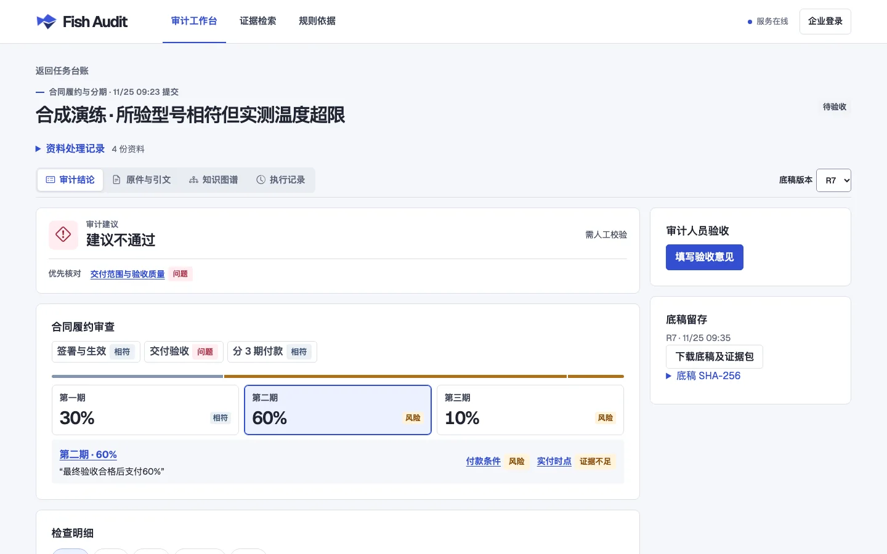

# Fish Audit 产品界面与交互设计

本版面向中小企业的财务人员和审计人员。首次来访者可用一笔采购追查验收疑点，正在办案的人可直接从工作队列进入底稿。[产品首页](http://127.0.0.1:8000/) · [审计工作台](http://127.0.0.1:8000/app)


## 工作台快速定位与精简看板

看板默认突出任务名、当前状态和疑点。水印合成任务标为「演练」，版号留在卡片底部。打开「筛选 → 显示卡片详情」可同时显示审计范围和附件数，偏好保存在当前浏览器。卡片上的速览入口可查看单个任务。

点顶栏放大镜，或按 ⌘K / Ctrl+K，可以找到当前工作区可用的操作。在底稿里输入「首款」、规则号或文件名，可直接展开待核发现或打开该版原件。方向键选择，回车打开，Esc 返回。案件处理中可直接跳到逐份进度。 [手机快速定位实拍](quick-find.webp)

## 分期付款的核对时点

在「合同履约审查」中选择第二期，展开「首款凭证」。提交时可能已有三万元足额回单，选「验收款实付日」则可能看到付款前只有一万元。每笔首款旁列出原件日期和金额，标出属于此前、当天或日后，点击即可核查原行。多笔验收款可逐张选择。日期相同的首款不会自动计入实付日前数额。未知金额显示「待核」。有回单但用途不明时，可展开「查看回单用途」逐张核对原栏。 [实付日对照实拍](prior-payment-day.webp) · [水印 R16](http://127.0.0.1:8000/workpaper/9371211c420b435b803a3aed73d13142?rev=16)

## 首页的原件对照

首屏点「原件对照」即可查看同一笔采购的合同标准和验收实测。桌面并排、手机上下排列，同步缩放从整页到原行，两份 PDF 各有独立入口。图框随缩放定位到归档物理行。 [双页实拍](public-source-compare.webp) · [成品首页](http://127.0.0.1:8000/)
## 按设备检查验收记录

在「合同履约审查」选中一台设备，可以查看它的每条读数及合同限值，点击数字打开该版原件。短缺时默认定位第一台没有读数的设备，超限时优先定位异常设备。同台重复会列出各条记录。合同只约定抽检时，清单中其他设备采用中性颜色。设备超过六台时用下拉选择。在小屏上，普通设备列表每行显示两台。[桌面底稿](inspection-coverage.webp) · [手机超限案例](inspection-hot-mobile.webp)

「检查明细」默认展示问题、风险和缺证项，状态条按本版实际项目数绘制。点某类结果可单独查看，点「全部」可回看每项程序。首页的「设备抽检」也可以操作，公开演示只读取随前端发布的水印原件。[检查明细实拍](inspection-findings.webp) · [首页手机演练](landing-inspection-mobile.webp) · [进入首页演练](http://127.0.0.1:8000/?scene=inspection#workflow)

## 从哪里进入

| 入口 | 到达后可做的事 | 数据范围 |
| --- | --- | --- |
| 产品首页 `/` | 切换履约原件、核对付款条件、比较签章单位名称或逐台检查读数 | 三笔独立的合成案例、六份公开的水印 PDF。无需账号或模型调用。 |
| 工作台 `/app` | 搜索任务，打开速览，提交资料，跟踪逐份进度，进入底稿签收 | 本机模式展示本机任务。企业模式根据会话、企业和角色取数。 |
| 企业登录 `/app#account` | 登录、创建企业或接受邀请，切换已加入的企业 | 企业账户及其可访问的工作区。 |
| 固定底稿链接 | 从某一版的条款、发现或引文回到对应位置 | 本机与企业各自校验案件、版本和原件访问范围。 |

产品标识返回首页，工作区主导航可打开工作台、证据检索和规则依据。管理员还有企业成员入口。旧的 `/#case/…`、`/#w/…` 和 `/#invite/…` 书签保留原片段转入工作台。

## 产品首页


点首屏「查看验收原件」或流程区的「核对这张验收单」，可以在合成验收报告上切换三处印刷记录。方向键选择前后原行，「整页」查看水印及上下文。关闭窗口后焦点回到原入口。「原始 PDF」可单独打开。页图按需载入，企业模式下的公开首页也可使用。[手机核图实拍](landing-evidence-reader.webp) · [三处印刷原行](../../3rd/showcase-provenance.md#展示原件)

首屏展示 R7 合成采购案例。验收单写着「合格」，实测柜温为 8℃，超过合同约定的 4℃。「读数对照」显示两个数值。「看原行」并排展示合同和验收单上的对应行，点页图可打开各自的 PDF。「原文摘录」保留验收日期、数量和结论栏。方向键可切换文件，Home 和 End 到首末文件。页面下方可分别核对 30% 生效款、60% 终验款和 10% 质保金，默认展开终验款。点击占比圆环或用方向键可以切换期次，圆弧长度对应合同约定占比，各期实付金额可在回单中核查。[分期占比实拍](installment-share.webp)[三份 PDF、原行与底稿版本](../../3rd/showcase-provenance.md) · [手机首页](home-mobile.webp)

## 签章主体对照

在首页审计流程区切换「验收读数」与「合同签章」。签章案例将采购方、甲方签章和单列印章单位按同一左边线排齐，琥珀色下划线标出多出的“杭州分公司”。点任一栏可查原页的对应行，也可切到整页阅读上下文。两个案例分别展示所据的 R7 与 R9。[首页签章演示](http://127.0.0.1:8000/?scene=signing#workflow) · [手机首页实拍](landing-signing.webp)

固定版底稿优先展开需处理的一方。页签有「差异」「待核」「相符」文字，切换至另一方时，总览仍保留本案的名称差异。审计员可打开精确原行或直接跳至待核款项。同一方重复出现的印章单位各占一行。「知识图谱」中的「签章主体的原行关系」可分别打开一次比较所据的两个端点。查看历史底稿只显示该版记录的结果。[桌面实拍](signing-party-difference.webp) · [手机实拍](signing-party-mobile.webp) · [设计参考](../../3rd/product-research.md#从名称差异回到合同原行)

### 扫描用印页

甲方、乙方各有一个页签。点「双页对照」可同时读合同约定主体和另一页的用印记载，点任一原件可放大核对。「影像已核」表示该栏有对应版本的核图回执。还需通读整页时，底稿保留合同生效和付款期次的待核状态。

桌面将扫描缩略图与三行主体名称并排放置。手机将原页收成一个可点击的文件条。双方分别用印时，切换页签会带到相应签章页。名称遮挡时可手动翻页。未读到签章栏的附件仍可打开整页。[双方分别回传的原件](signing-images-desktop.webp) · [手机上的签章核对](signing-images-mobile.webp) · [两页对照](signing-images-compare.webp)

## 任务队列与资料提交


首次进入审计员工作区，建议看板按底稿显示「建议不通过」「需要人工校验」「建议通过」，还有未出建议的任务时显示第四列。每列先取三笔，列头显示完整命中数。卡片标题打开卡上标明的版本。「查看全部」进入同一建议的可翻页台账，筛选标签可直接移除。手机一次显示一组。浏览器记住上次选择的视图。[手机看板](desk-mobile.webp)

按 `/` 搜索任务，点「筛选」调整业务范围和排序。上方队列数量取自当前检索范围，「有疑点待验收」是待验收任务的子集。合成任务保留「合成演练」标记。

点任务行末的速览图标，可以留在台账内查看原件清单。处理中会自动刷新阶段和进度。审计员可以看到本版建议、最多三项待查发现及已登记的人工决定，点发现跳到所据版本。经办员工可跟踪自己的任务进度。Escape 关闭速览，键盘焦点回到原任务。[任务速览实拍](task-preview.webp)

新建任务时可分次选择或拖入文件，清单显示本案份数、合计大小、沿用原件和每份文件的问题。点击「资料要求」查看当前审计范围的备件说明。提交后可离开页面，稍后从「处理中」查看分页、模型解析、建图、规则执行和专家复核。[手机提交资料](intake-mobile.webp) · [手机工作台](desk-mobile.webp)

## 并排对照两份原件

协议修改某一期付款条件时，期次卡显示现行条款，回单旁另列「实付依据」。点击依据打开当笔对应原行，「对照新旧条款」可标出收票前提的新增文字。盖章及实付只有日期且恰在同一天时，时间线上共用一个日期节点，两处原件可分别打开。票号与双方盖章日放进「更多凭据」。[付款前后采用不同条款](payment-edition.webp) · [同日待核的手机视图](payment-edition-mobile.webp) · [两版付款条款](payment-clause-diff.webp)

遇到代理签约，从受影响的期款点「对照签约授权」即可并排查看原行。禁付预款对照该期付款条款，额度上限对照合同含税总价。遇到需分别取得两份书面批准的情形，可直接对读同一委托书中的两行。点击任意原行打开整页。[授权限制与预付款原行](mandate-terms.webp)

分期卡片默认选中最需要处理的一期，同时考虑付款条件和实际付款时点。点「条件核对」查看各项证据是否相符，点「时间线」按单据日期查先后。点击日期打开该版原页。涉及收票时，可并排对照发票与签收登记的号码，或收票日与回单付款日。手机将日期排成一列。首页的分期演练也可切换「按期次」和「按日期」，三个日期分别直达合同、验收报告和付款回单。[首页日期视图](landing-dates.webp) · [桌面时间线](receipt-timeline.webp) · [手机时间线](receipt-timeline-mobile.webp)

从底稿的「对照验收原件」可同时查看合同或补充协议的标准与验收读数。有独立期次的，从那笔期款点「对照本批原件」可直接看该批的原行。点击任意一侧页图进入完整原页，按 Escape 回到对照位置。[分批验收原件对照实拍](batch-quality-compare.webp)

点「换引文」可按文件名、字段或原文查找，方向键和回车可完成选择。范围是当前版本、当前发现引用且在图谱有关联的本案观察。原生文字有坐标时框选原行，影像观察按整页呈现，并列示核图状态。跨案记录、规则出处、算式和原始结论可切换到「取证明细」查看。

## 从放行权限查到银行实付

点选一期验收款，金额占比下方分别显示「付款条件」和「实付时点」。暂缓从验收日起算有据时，可从当天的「本期暂缓」直接打开原件上的付款意见。若实付早于签字放行，默认时间线用琥珀色菱形标出付款日，并写明相差几天。点击「对照放行与实付」可并排核查两张原凭证。只有日期且放行与实付同日时，两项共用一个日期位置，界面提示补核时分。[桌面时间线实拍](payment-release-dates.webp) · [提前一天实付的底稿](http://127.0.0.1:8000/workpaper/2bf163a2b272462d9e535e6f1d3e25fe?rev=7)

签认人或验收单号存疑时，打开「付款意见」即可看到对应引文。「暂缓」「权限」「放行单」分别定位验收原件、合同约定和签发记录，支持方向键切换。只有双方都有可定位观察才提供双栏对照。手机上下排列交付结论和放行记录，审计员可轻点原行查看固定版本整页。[手机签认核查实拍](payment-release-signer-mobile.webp) · [两位签发人的核对底稿](http://127.0.0.1:8000/workpaper/0e2bdd2017bd44a9b9546f00f0c9ef55?rev=7)

## 维修工单

工单是照片或扫描页时，缩略图旁的栏位分别标出「待核图」和「已核图」。点击栏位可在同一底稿版本打开整页与对应引文。扫描件有封面时先展示提取到工单状态的一页，可通过页码选择器回看封面。状态栏记为已关闭而缺少可引用的采购方签认时，选择「待查原页」核对签认栏。[两页扫描件](http://127.0.0.1:8000/workpaper/2a6a70305077484f9108a620d2eda3c1?rev=3) · [扫描核对实拍](warranty-scan-review.webp)

在原件查看器里可向左或向右旋转 90°，按需放大至适宽的四倍。「适宽」保留阅读方向。文字层行框随纸面转动，纯影像只显示归档整页。页图暂时无法载入时，可以就地重试同一版本，重新读到原页后恢复核图操作。[手机照片转正实拍](workpaper-photo-rotation.webp)

在「合同履约」选中第三期质保金，有归属待核或已关联的维修工单时，「本期证据」自动打开「维修工单」。标题下面直接展示两处归档原行。确认单写着「无未关闭缺陷」而工单仍记「待维修」时，可对照两份状态栏。实付早于工单关闭时，可直接核对回单付款日和工单关闭日。两张原件的采购标的不同，则并排查看各自的标的栏。[确认单与待维修工单](http://127.0.0.1:8000/workpaper/4a29c90065c3460689d8cdd41b8fc348?rev=12) · [回单早于工单关闭一天](http://127.0.0.1:8000/workpaper/2e2d1c6223714191a791940b8661e02d?rev=6)

点击原行打开所在页，选择「双页对照」同时查看两份原件。手机上依次显示两处引文。展开「工单详情」可核对编号、故障事项、报修日期和采购方关闭签认。多张工单分别列出，默认选中有风险的一张，支持方向键切换。「质保时点」仍可查看整个合同期间。[桌面实拍](warranty-ticket-conflict.webp) · [手机实拍](warranty-ticket-payment-mobile.webp) · [两张工单的底稿](http://127.0.0.1:8000/workpaper/920ea04963ef4f68905ff87533133fd4?rev=9)

## 质保金时点

在合同履约区选中质保金期次，「质保时点」把终验或复验、合同推算末日、期满确认和每笔已关联回单放在同一条日期标尺上。蓝色虚线标出该案提交日。提交后的落款列出相差的天数。选择「全程」查看整个质保期间，选择「±7 天」看清接近提交日的几项记录。

点击一行或按方向键查看所据原件。选择推算末日会同时显示起算原件和合同期限条款。桌面可读原图局部，窄屏保留逐字引文，点击可打开整页。确认单的缺陷记载和合同的返还条件各有一个原件入口。[桌面实拍](warranty-cutoff.webp) · [手机实拍](warranty-bank-mobile.webp) · [提交日尚未届满的演练](http://127.0.0.1:8000/workpaper/9c980cca17134c3da2eef3ffba8c4f8c?rev=6)

## 签约授权月历

合同由受托人签署时，「签署与生效」下方出现该方的授权月历。浅蓝底是委托书所列期间，实心日期是合同签约日，点状标记对应原件记载。同一天可有多项记录。日期超期、出具过晚或当日先后待核时自动展开。期间相符且授权范围另有限制时，标题同时提示签约权限风险。[签约早于出具的桌面实拍](mandate-calendar-issuance.webp) · [手机同日核查实拍](mandate-calendar-same-day-mobile.webp)

点击日期或在右侧四项原件间使用方向键、Home、End，可查看对应印刷行，点原行打开固定版本整页。「对照签字与受托人」并排展示合同签名和委托书姓名。日期存在疑点时可再对照这两个日期。授权另有限制时可查看原权限栏或对应的合同条款。截止日断字时保留原文，纯影像委托书可直接核对整页。[同日出具与签约](http://127.0.0.1:8000/workpaper/675e19de12394c95a68195a342d58298?rev=5) · [扫描委托书](http://127.0.0.1:8000/workpaper/de19612cc7ed4319bd826914ce5bd911?rev=6)

## 验收单上的付款意见

选择合同期次后，「本期证据」可切换条件核对、时间线和付款意见。验收单另载暂缓或相反意见时，默认打开意见视图，已有的实付时序疑点优先显示在时间线。左侧为交付验收判断，右侧为这笔期款所据的原行。短引文有坐标时直接显示从固定版本页图裁出的墨迹。点击引文即可打开整页。手机按阅读顺序上下排列两项。

同一张单写有两种意见时，可点「暂缓」「同意」或用方向键切换，也可点「对照两项意见」同时看两处原件。实测超限的案例可直接对照合同上限和验收读数。对只有印刷行号的意见，显示逐字原文并可定位到本页引文。完整审计解释、依据和图谱关系可在检查明细里展开。[桌面实拍](acceptance-opinion.webp) · [手机实拍](acceptance-opinion-mobile.webp) · [直接打开相反意见演练](http://127.0.0.1:8000/workpaper/1f8712f4118d4a239da2aee83cf1c768?rev=6)

## 从审计建议回到原件

有整改记录时，可从相关期款点「对照整改与复验」。双栏能切换初验与复验读数、整改状态与关闭结论、日期和缺陷编号。每张整改单先显示一处优先核对的原行，其余依据可展开。日期的文字层与字段抄录不同时，先显示印刷原行，点「对照字段抄录」可看两者差异。在完整原页中，可来回切换状态、日期和附注，放大倍数随选择保留。[整改附注桌面实拍](repair-compare.webp) · [日期断字手机实拍](repair-date-mobile.webp)



底稿先显示审计建议、人工校验要求和一项优先发现。点「优先核对」会展开原检查，显示完整判断和执行依据。检查明细可按问题、风险、证据不足或相符筛选，数量来自当前版本。

合同履约区分别列出签署生效、交付验收及分期约定。用鼠标或方向键选中一期，查看该期条款、付款条件、实付时点或未关联回单的提示。默认优先选中问题、风险或证据不足最重的一期，程度相同时按合同期次排序。仅在分期规则相符且合同占比合计为 100% 时显示比例条。条长表示合同约定占比，实际付款另看回单。[R7 合成底稿](http://127.0.0.1:8000/workpaper/ed7751a871aa4fb1a8574eddada0254b?rev=7)

选中分批采购的一期，可展开该期适用的「验收备注」或「付款意见」，查看原行、读图状态和页图。两种意见同时出现时在同一个折叠项中对照。图谱也能沿交付条款或付款条款回到同一份原件。[第三期两处原文的界面实拍](batch-payment-remarks.webp) · [打开 R11 分期底稿](http://127.0.0.1:8000/workpaper/f77380ea75204f9793b729a4e1d5c7b4?rev=11&finding=H04-7)


董事会审批单有保留意见时，可从当前期款进入所据决议。原页右上方的「对照第 10 行」「对照影像引文」或「对照决定栏」会切换本页依据，并保留放大倍数。下拉框列出该页全部待核原文。电子原行有坐标时会框选位置，影像引文只列有据的原文和核图状态。[打开合成采购的审批页](http://127.0.0.1:8000/workpaper/a0d6cf53f04a4c6c9ba65f7a06f62e1b?rev=8&fact=d01%2Fp1%2Ff8) · [审批原文对照实拍](board-compare.webp)

在「核对合同约定与实收型号」中，对型号有异议的原件会显示经办人、核图意见和「查看提出异议的型号引文」。点击可定位到对应的原页和观察。后来重新核图确认后，从旧版底稿进入仍可看见当时的异议。

从发现打开引文时，右栏优先显示所选事实。「本页引文」可切换到另一条事实或查看全部。原页支持适宽、125%、150%、200%，框选随页图同步缩放。具有文字层坐标的引文可以定位到原行，纯影像资料保留页图、观察与人工核验状态。手机可切换「看原页」和「看引文」。签收决定与所据版本一同保存。

## 颜色与含义

页面底色为白色，工作台外围用冷灰 `#F6F7FA`。单号、金额和签署日期用石墨色 `#202431`。首页原件展示区用海军蓝 `#1D3454` 衬底，企业登录页使用浅蓝方格，PDF 原页按档案中的图像显示。[共享色值](../../frontend/brand.css) · [四款海外软件的实际用色](../../3rd/interface-color.md)

| 用途 | 文字与底色 | 审阅人看到的操作或含义 |
| --- | --- | --- |
| 主操作、选中项 | 钴蓝 `#2851C5`，白底或浅蓝底 `#EDF3FF` | 「新建审计」使用实底白字，当前队列有浅蓝底，活动页签带蓝线。 |
| 已相符或人工已确认 | 蓝灰 `#415673`，底色 `#ECF1F7` | 显示「相符」「人工已确认」等文字。人工确认旁有勾形标记。 |
| 风险、证据不足、退回补件 | 琥珀色 `#814B0B`，底色 `#FFF3DC` | 提示继续检查付款条件、补充原件或核实疑点。 |
| 问题、矛盾及中断 | 莓红 `#A32C40`，底色 `#FFEDF0` | 已测得的柜温超出合同上限，首页直接标出 8°C 和原因。 |
| 人员复核流程 | 紫色 `#65428F`，底色 `#F3EEF9` | 「待复核」表示任务已进入复核人的队列。 |

核图时，原页上的半透明黄框与右侧浅琥珀背景标出当前选择的引文。证据状态由旁边的「已匹配文字层」「待核原图」等标签说明。[配色验收](verification.md#配色验收)

## 视觉与行为约定

| 元素 | 用法 |
| --- | --- |
| 字体 | 首页主标题和工作台使用中文无衬线字体，原件题名与分期案例标题保留 Noto Serif SC。Geist 用于拉丁字母和数字。 |
| 状态 | 流程状态使用中性色或蓝灰，问题、风险及相符分别带明确中文字样。编号、百分比、日期和金额保留可核对的文本。 |
| 动效与键盘 | 首屏轻量入场。减少动态效果偏好下直接呈现。文件标签、队列、底稿与原件入口可用键盘操作。 |
| 移动编排 | 首页窄屏叠放文案与演示。680 像素及以下的工作台用分组按钮切换看板，核图在 760 像素及以下采用上下布局。 |

## 复核与维护

本版在 320 至 1440 像素宽度的浏览器内验证，企业流程使用隔离数据库和实际模型。视觉工具的开放项、逐项取舍与真实流程结果记录在[验收记录](verification.md)。

入口布局和导航位于 `frontend/landing.html` 和 `frontend/index.html`，公共品牌资源在 `frontend/brand.css` 与 `frontend/assets/`。审计判断读取服务端发行的底稿。首页演示的原件更换时，需同时更新原文摘录、固定样本摘要和相关浏览器回归。[海外产品界面观察](../../3rd/product-research.md) · [字体、研究及项目来源](../../3rd/project-sources.md)

在仓库根目录可执行下列浏览器回归。前两项检验访客在本机与企业实例进入产品的路径，后两项使用本机已有的水印演练任务。

```sh
node frontend/tests/workspace.mjs --product
AUDIT_PRODUCT_ORIGIN=http://127.0.0.1:8010 node frontend/tests/workspace.mjs --product
node frontend/tests/workspace.mjs --sample-desk
node frontend/tests/workspace.mjs --design-case ed7751a871aa4fb1a8574eddada0254b
```
