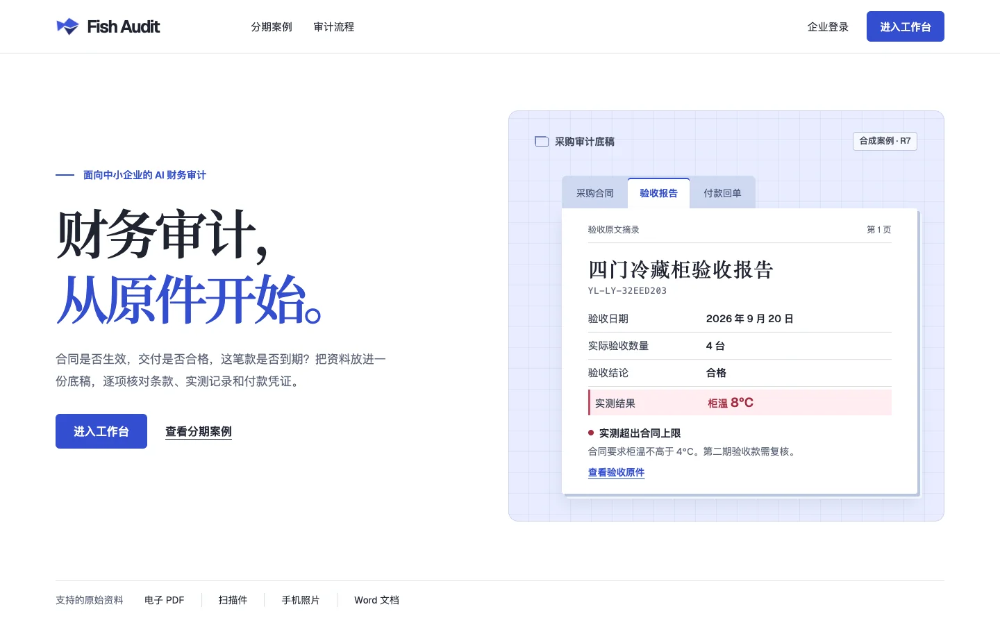
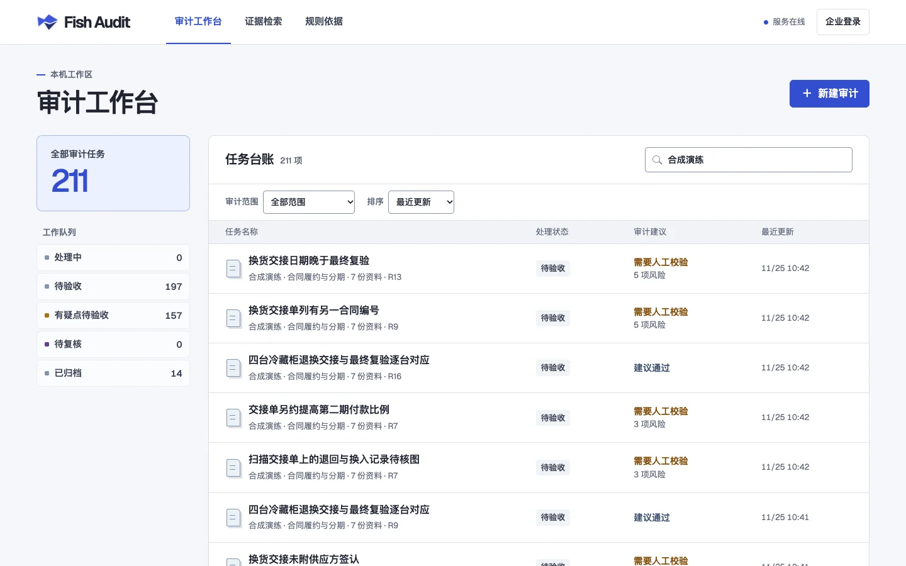
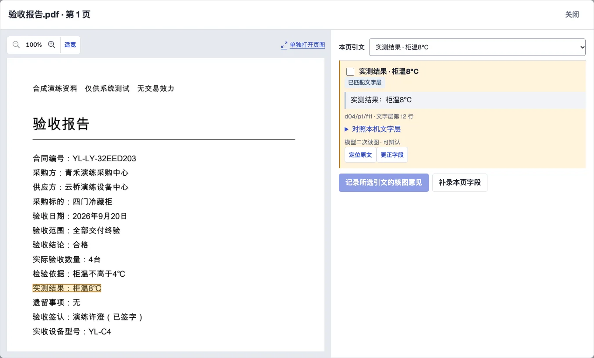

# Fish Audit 产品界面与交互设计

## 在页面上记录走查意见

1. 在首页、工作台、底稿或原件上点「提意见」。桌面宽窗可选「并排走查」，左侧继续操作，右侧写意见。窄屏直接在浮窗输入。
2. 要指出某个按钮或数字，点「点选控件」再选它。要指出原件上的字或印迹，打开已出具底稿的原页，点「标记原图」后点击相应位置。用键盘时，方向键可移动标记，Enter 确认，Esc 取消。[试走第二期会签案例](http://127.0.0.1:8000/workpaper/8debfd4a45424070a4fbedb915de1667?rev=10&view=payment-checks&stage=H05-8) · [窄屏上的两处姓名](approval-names-joint-mobile.webp)
3. 写下希望怎么改，点「保存意见」。「已记录」可回到当时的底稿版本、控件、原行或图上标记。点回控件后，蓝框会保留到你再次点击或按键。走完后在同机 Codex 说「按本机走查清单修改」，或点「复制给 Codex」贴进指定对话。[在合同原行旁写意见](approval-names-walkthrough.webp)

对照两版底稿时，展开「核对三处原文」。例如，想在 R3 的代用决定旁看到收件时间，就点「提意见 → 点选控件」，再点 R3 的「协议决定」。意见会记住 R2 / R3、选中的 R3 以及补充协议第 1 页第 11 行。桌面上两版原文并排展开。手机上可单独展开一版，底部有「收起对照」和「提意见」。[试走这笔 6 万元付款](http://127.0.0.1:8000/workpaper/f90afd53772c43028d74e6f831d1d4e0?rev=3&view=revision-comparison&prior=2&entry=new-H05-8) · [电脑对照原文](revision-approval-originals.webp) · [手机上给 R3 留意见](revision-approval-feedback-mobile.webp)

周末可以从一笔第二期验收款开始。点「提意见 → 点选控件」，选中「实付比协议所记批准日早 1 天」，写下希望怎么改。例如「希望在这里看到当时收到批准文件的时间」。保存后从「已记录」回到 R3，可继续核对这条结论。如果想指出批准书的具体字句，打开补充协议第 11 行，再点原页上的「提意见」。[打开这笔 6 万元验收款](http://127.0.0.1:8000/workpaper/f90afd53772c43028d74e6f831d1d4e0?rev=3&view=payment-checks&stage=H05-8) · [手机上给结论提意见](substitution-approval-date-mobile.webp)

如果现场想说「这笔验收款旁应该能看到代用批准人」，可在待签案例里选中写有「须双方签字后生效」的补充协议第 9 行。要核实是否已签，可以从同一笔付款打开「补充协议签署」。[待签案例](http://127.0.0.1:8000/workpaper/8184e581520747078afb38e74edf5f41?rev=2&view=payment-checks&stage=H05-8) · [手机走查](substitution-feedback-mobile.webp)

周末可以先走一笔已付的 6 万元验收款。合同列的是 `FA-0104`，验收报告列的是 `FA-0109`。如果希望付款页能直接打开对应的设备铭牌，点「提意见 → 点选控件」，选中「实收设备序列号」后写下建议。若想标出验收报告上的具体位置，先点这行打开原件，再提意见。[从第二期实付开始](http://127.0.0.1:8000/workpaper/59291d68a1c34501a886c1cb063f063e?rev=3&view=payment-checks&stage=H05-8) · [手机走查](delivery-register-feedback-mobile.webp)

在一笔 6 万元验收款的底稿中，可以直接看到原文「柜温1 2℃」和模型摘录「柜温12°C」。点「提意见 → 点选控件」，再点这条读数，就能把建议留在第二期实付检查。若想指出原件上的间距，先点读数打开验收报告第 12 行，再提意见。两种意见都可从「已记录」回到当时所看的位置。[试走第二期实付](http://127.0.0.1:8000/workpaper/9991314d0b1e447493df87bb49849c79?rev=7&view=payment-checks&stage=H05-8) · [桌面原文与摘录](measurement-spacing-payment.webp) · [手机点选控件写意见](measurement-spacing-feedback-mobile.webp)

例如，要反馈「验收时想同时看到实际签字页」，可打开下方底稿，点「提意见 → 点选控件」，选中「采购合同.pdf · 第 1 页 · 第 19 行」再保存。从清单打开会回到当时的验收检查。若要指出约定里的某个字，先点该条款打开合同原页，再在原件上提意见。[试走 6 万元第二期的验收底稿](http://127.0.0.1:8000/workpaper/eb8396ed0fe34732935e25645f6ad430?rev=7&view=acceptance-checks) · [手机点选并写意见](shared-signing-feedback-mobile.webp)

例如首期回单已经付款，但合同第 19 行还要求双方代表签字。想调整回单上的呈现，就点「点选控件」并选中签署条款。想指出合同上的某个字，就先打开原页再提意见。桌面侧栏可以边看回单边写，手机浮窗只列底稿版本、文件名和页行。已保存的两种意见分别回到原控件和原文。[走查这笔 3 万元回单](http://127.0.0.1:8000/workpaper/fe3e11f28208499bb9a19238bbf5439c?rev=6&view=payment-checks&stage=H05-8) · [桌面并排走查](signing-form-sidebar.webp) · [手机原行意见](signing-form-feedback-mobile.webp)

合同第 19 行要求核对仪器允差时，可以在第二期付款里点「起草补件意见」。人工验收表会带入合同和验收单各自的页行，审计人员可以修改文字，确定后点「确认退回补件」。如果走查时想建议改进这个按钮，点「提意见 → 点选控件」再选它。正式退回之后，从走查清单仍能回到这版所引的精度说明。[打开第二期付款](http://127.0.0.1:8000/workpaper/57abf85981374ed39f5cd9cae5175f2c?rev=8&view=payment-checks&stage=H05-8) · [桌面上的合同与读数](inclusive-precision-payment.webp) · [手机上的补件草稿](measurement-return-mobile.webp) · [验收范围待确认](measurement-scope-mobile.webp)

**试着在验收原件上留一条意见。** 打开 R8 的取整案例，点「测量精度说明」就能看到验收报告第 15 行。保持原页打开，点「提意见」，写「请在这里加一个补原始检测记录的入口」，再点「保存意见」。从「已记录」点回时会打开当时的版次，并重新标出这一行。也可以从第二期付款检查进入，查看同一读数为什么影响付款。[打开 R8 验收底稿](http://127.0.0.1:8000/workpaper/801a3b8b9ddb4c20ad477d377ed473b9?rev=8&view=acceptance-limits) · [手机原件定位](precision-original-mobile.webp) · [在手机上写意见](precision-feedback-mobile.webp) · [第二期付款的边界对照](strict-acceptance-payment.webp)

在水印采购合同第 2 页，可以直接点用印单位末尾的「杭州分公司」，写「希望在这里对照合同抬头」。这笔底稿已出到 R6，下面的链接仍打开 R5 的原字。验收报告的另一个例子指向手机上的签认栏。回看时点「定位走查标记」即可重新找到它。[打开合同用印处](http://127.0.0.1:8000/app#case/30025f7db2dd44b195724079387031cd?rev=5&walktab=evidence&walkdoc=d01&walkpage=2&walkpoint=6342.2203.2c270bf7c0f1633ddb9a85f684aa7fa4074c9f878ffa6459abfef61ff6a60f5f) · [桌面并排截图](walkthrough-scan-point.webp) · [打开验收签认处](http://127.0.0.1:8000/app#case/c3975bbf83cc45df8106e6737fdd03c6?rev=3&walktab=evidence&walkdoc=d02&walkpage=1&walkpoint=3735.6015.820989f41d16482ddb121dce9a184af5789128473c5eaa3c046b32b8ce8e3949) · [手机截图](walkthrough-acceptance-point-mobile.webp)

看验收质量时，可以直接点「终验实测」「验收单结论」「合同约定」或「检验依据」打开各自的原页。看着验收对照点「提意见」，即可就整项写意见。要说明哪个限值难懂，点「点选控件」再选该限值。保存的意见会带上案例、版次、字段及页行。从清单打开时，会重新展开这项验收发现。第二期回单使用同一组控件，并列出两份单据的日期。[打开验收对照](http://127.0.0.1:8000/workpaper/420d42bf7d1240de9045e24def29a20a?rev=8&view=acceptance-limits) · [手机验收页](inspection-limits-acceptance.webp) · [在检验依据上写意见](inspection-limits-feedback.webp) · [桌面第二期付款](inspection-limits-payment.webp)

<details>
<summary>其他原件和控件的走查示例</summary>

走查两人会签时，可以点开合同第 19 行和审批单第 12 行，对照「顾明远、周茵」和「顾明远、林知行」。要对这一栏提意见，选「提意见 → 点选控件」后点名单。若另有补充协议，手机也能并排看到新旧名单，并从盖章日、审批日和审批单具名栏打开各自原行。[打开合同会签](http://127.0.0.1:8000/workpaper/e0e29a17670d44dd9941e21c694efbc7?rev=7&view=payment-checks&stage=H05-8) · [桌面截图](joint-approval-names.webp) · [打开补充协议会签](http://127.0.0.1:8000/workpaper/aab36e9a94034a58944d22c05d0b9ed1?rev=9&view=payment-checks&stage=H05-8) · [手机截图](joint-approval-change-mobile.webp)

可以从「回单所引验收单」开始试。水印案例的回单明列一张合格复验单，合同约定四期、只列了三期。在「提意见 → 点选控件」里选「付款安排待核」即可写下想怎么改。要查业务依据，点「查看 R6 · H03 依据」可打开这一版合同的总述和三条付款条件。手机走查也能选中同一位置。[打开这笔第二期款](http://127.0.0.1:8000/workpaper/7aa5e0f3f63340b290e64bdc84d61676?rev=6&view=payment-checks&stage=H05-8) · [桌面并排走查](incomplete-schedule-walkthrough.webp) · [在手机核对提前三天的回单](incomplete-schedule-mobile.webp)

在三期条款齐全的采购底稿里，选「提意见 → 并排走查 → 点选控件」，点「合同列明 3 期」后写意见。再点一次这个按钮，合同会翻到第 1 页第 15 行，已写的意见仍指向刚选的按钮。保存后可在当前原行另记一条。手机使用「提意见」浮窗，两条意见都能从「已记录」回到各自的位置和版本。[打开 R11 分期安排](http://127.0.0.1:8000/workpaper/744d182cfd7f46a49d3e5bb8da0e2685?rev=11&view=payment-checks&stage=H03-4) · [原件旁的走查侧栏](installment-count-walkthrough.webp) · [手机上的分期检查](installment-count-mobile.webp)

周末可以从这个 6 万元的第二期付款开始。点「补充协议约定」可看第 10 行的新名单，点「最后所列盖章日」可看第 16 行的日期。若想反馈这两个值的呈现方式，可先点「提意见 → 并排走查 → 点选控件」，写到一半也能继续打开原件。手机上在「提意见」浮窗保存。从「已记录」回来时，系统会打开当时的 R10 和选定的位置。[试走第二期签批人变更](http://127.0.0.1:8000/workpaper/aaf9593f62cc43f587eaedec9a22a2f4?rev=10&view=payment-checks&stage=H05-8) · [桌面边看原件边写](approval-change-walkthrough.webp) · [手机付款底稿](approval-change-mobile.webp)

对签批和扣款先后有意见时，可以直接点选「实际扣款时间」。打开下面的采购底稿，点「提意见 → 并排走查 → 点选控件」，再点 09:15。继续点这个时刻，左边打开银行回单第 1 页第 11 行，右边保留正在写的意见。在原页另写一条，系统会记下这次的页行。在「已记录」里点相应位置，就能分别回到付款卡或银行原页。手机用「提意见」浮窗。[走查第二期付款](http://127.0.0.1:8000/workpaper/32461158cc804f4d8296c628dbd448aa?rev=8&view=payment-checks&stage=H05-8) · [桌面并排记录](approval-clock-walkthrough.webp) · [手机核对两个时刻](approval-clock-mobile.webp)

周末可以从《验收报告》第 5 行试走一遍。打开「供应方核字」，点「看原件第 5 行」，再点「提意见」。录入时会带上底稿版本、文件、页和行。桌面可选「并排走查」，一边看原件、一边写。即使案件后来出具了新版，从「已记录」也能回到当时漏抄了“应”字的那一版。走查结束后点「复制给 Codex」即可带走意见和定位链接。[打开 R9 核字原页](http://127.0.0.1:8000/workpaper/066d632f141e4f9ab63d43c1ef2371b7?rev=9&fact=d06%2Fp1%2Ff3) · [原件旁的桌面侧栏](party-reading-walkthrough-desktop.webp) · [手机走查](party-reading-walkthrough-mobile.webp)

在「分期与付款」里打开付款后才审批的水印例子，点《付款审批单》的「审批日期」，原件会定位到第 10 行。点「提意见」即可记下对这一行的建议。如果想指向底稿里展示日期的控件，先点「提意见 → 点选控件」再选日期。两种位置都可以从「已记录」重开，保留当时的底稿版本。[打开第二期审批单 R7](http://127.0.0.1:8000/workpaper/7fd2600efdb14666834148f59684cf51?rev=7&view=payment-checks&stage=H05-8) · [桌面并排记录实拍](installment-approval-walkthrough.webp) · [手机上的付款检查](installment-approval-mobile.webp)

周末走查时，先点「提意见」。浏览器宽度达到 1280 像素后可选「并排走查」，在右侧写意见，左侧继续切换检查项或翻原件。写到一半打开另一份原件，草稿仍指向开始记录的位置。要把意见指向某个按钮或引文，选「点选控件」再点它。保存后侧栏可以接着记下一条。[从第二期付款检查开始](http://127.0.0.1:8000/workpaper/63a8bef1d5d8418e9aed9d38fa2f282f?rev=11&view=payment-checks&stage=H05-8) · [对照复验报告写意见](walkthrough-approval-sidebar.webp)

手机上直接点「提意见」和「保存意见」。电脑上也可以用 ⌘ + Enter 或 Ctrl + Enter 保存。缩窄窗口时会带着草稿切到浮窗，关掉浮窗后可以继续看原件。在当前标签页回到记录位置可重开草稿。打开「已记录」可以逐条点回现场，也可以整轮「复制给 Codex」。

例如，对第二期回单旁的用途限制作修改建议，可点「提意见 → 点选控件」，再点《复验报告》第 21 行那句话。也可以先点原话，在展开的 PDF 上直接写意见。「已记录」里的两种链接分别回到当时的付款检查控件、底稿原页上高亮的那一行。「复制给 Codex」会带上这些位置和修改意见。[从水印底稿试用](http://127.0.0.1:8000/workpaper/66fa88c60aed4799a64ab73c0eb92495?rev=11&view=payment-checks&stage=H05-8) · [手机上的用途限制](inspection-use-mobile.webp) · [点选后写意见](inspection-use-feedback.webp)

在第二期实付点「核对回单所引的验收单」，并排的两个单号分别打开初验与复验原件。展开「核对付款条件与整改原行」，对「复验所引初验单」点选提意见，清单会记录所引文件及物理页行。以后从「已记录」回到这一条，系统会恢复底稿版次、打开那笔回单、展开原来的字段并标出来。[打开水印案例](http://127.0.0.1:8000/workpaper/e4cc7a317fe34db4a3df9acc0a165b99?rev=7&view=payment-checks&stage=H05-8) · [桌面实拍](retest-reference-desktop.webp) · [手机实拍](retest-reference-mobile.webp) · [现场提意见](retest-reference-feedback.webp)

周末走查可以从第二期付款开始。在「分期与付款」右上角点「提意见」即可输入。想指明问题时，选「点选控件」，再点「终验实测 8 °C」。蓝框会标出所选控件，意见带上版次、这一笔实付及《验收报告》第 1 页第 12 行。从工作台的「已记录」打开意见，会回到当时的回单。再点实测值，就能查原件。走完一轮可在本机告诉 Codex「按走查清单修改」，或用「复制给 Codex」带到指定对话。[开始走查](http://127.0.0.1:8000/workpaper/64cd9e64345841bab358728a6730f3d8?rev=8&view=payment-checks&stage=H05-8) · [点选第二张回单的实测值](payment-quality-feedback.webp)

质量对照并列合同上限与终验实测，下方按单据列日期。同日显示「同日，先后待核」。点读数或日期可看该项的原件引文，展开「核对条款与验收结论」可查付款前提、验收范围和回单用途。不同回单各有固定位置，历史底稿可从版次对照进入。[桌面实拍](payment-quality-desktop.webp) · [手机实拍](payment-quality-mobile.webp)

在董事会审批单选「签发版本」，可以直接对 Word 原批注提意见。例如点右下角「提意见 → 点选控件」，再点批注下的「第 1 页 · 第 8 行」，写下希望怎样呈现批准范围。意见清单带上底稿版次、签发版本、文件名和页行。从工作台的「已记录」点回这条意见，会恢复原来的标签并标出那个按钮，点一下即可看到批注所指的「审批决定：批准」。整轮意见可「复制给 Codex」。[亲自走查这份 Word](http://127.0.0.1:8000/workpaper/fe94943d9e304d729d783bc373d35342?rev=5&view=board-decision&filing=d01&part=signing) · [手机上的审批批注](board-approval-comment-mobile.webp) · [点选第 8 行后填写意见](board-walkthrough-mobile.webp)

「决议原文」并排给出合同约定和审批决定，各自能回到纸面位置。机构、日期和签认可按需展开。「签发版本」列出这份 PDF 的签后增量或这份 Word 的原批注。「关联期款」只列本版实际引用此凭证的付款条件及实付记录。从任一版的履约对照点「董事会审批原件」也可进入该版。[签后修订的 PDF](http://127.0.0.1:8000/workpaper/33abdfcee2ba4133b08a4b140a7e30fe?rev=7&view=board-decision&filing=d01&part=signing) · [桌面上的签署范围](board-approval-signed.webp)

底稿顶端点「对照前版」可并排读两版发现，手机上按先后版次排列。默认打开最近的前版，选择框可切换其他已出具版本。先看状态和原文，要看这版执行了什么核对程序，可展开「核对依据」或「完整发现与依据」，再点「原件引文」追查页行。同一期有两张银行回单时，选择框显示各自的文件名。[试查第三期质保金](http://127.0.0.1:8000/workpaper/fd51542fc29c401196842a0a207f1e8b?rev=6&view=revision-comparison&prior=5&entry=new-H05-8) · [手机上的两版底稿](revision-comparison-mobile.webp)

要指明哪一版的哪一行，可以展开该侧的引文，点「提意见 → 点选控件」，再点文件页行。保存后，「已记录」和「复制给 Codex」会带上对照版次、所选一侧的版号与文件页行。点清单的位置链接会重新打开对照并展开原先那条引文。[走查时点选期满单原行](revision-feedback-mobile.webp)

周末走查可以直接从这份质保金底稿开始。右下角选「提意见 → 点选控件」，点「银行回单」的日期并写下修改意见。编辑时蓝框标出选中的位置。「已记录」中的链接会恢复 R6、第三期的这笔回单和相应日期按钮。点按钮可看原页第 9 行。在阅读器切到另一条引文后再提意见，记录随当前引文定位。整轮走查的清单可以一次复制给 Codex。[打开水印底稿 R6](http://127.0.0.1:8000/workpaper/fd51542fc29c401196842a0a207f1e8b?rev=6&view=warranty-certificate&stage=H05-8) · [手机宽度点选截图](warranty-dates-mobile.webp)

点选质保期满确认单上的 Word 批注也会保存当时的版次和页行。从工作台点这条意见的位置链接可回到批注，再点「第 1 页 · 第 9 行」打开选中的正文。本机意见也可由开发人员直接读取。[打开水印底稿 R5](http://127.0.0.1:8000/workpaper/bd4e587110604a81b0a0cb4a028323ab?rev=5&view=warranty-certificate&stage=H04-7) · [手机上的走查记录器](warranty-walkthrough-mobile.webp)

在「放行单对照」中点「提意见 → 点选控件」，再点甲单或乙单的决定行。清单会带上原件文件名，位置链接会恢复当时的底稿版次、第二期和所选单据，并标出该行。点决定文字本身可查看物理原页。[打开两份水印审批单](http://127.0.0.1:8000/workpaper/42a2fd1a46f34d88af80e8c9634a244e?rev=8&view=payment-release&stage=H04-6&instrument=d06) · [手机实拍](release-comparison-mobile.webp)

在首页、工作台或站内原件阅读器点「提意见」，可边操作边写。点选控件为本条意见补充位置，按 Esc 可退出点选。底稿意见会记录当时的版本和标签页，站内原件还带资料编号与页码。打开有稳定元素编号的链接，页面会短暂标出相应位置。上传表单的链接保留审计范围。[手机点选原控件实拍](walkthrough-mobile.webp)

「已记录」里的位置链接可以重新打开。桌面和手机都可以把整轮清单复制给 Codex 或下载成 Markdown。本机模式的记录存入本地数据库。企业工作区按企业和账号保存个人意见，企业实例的公开页保存在当前浏览器。提交的内容是意见及位置，原件、截图和表单输入留在原界面。[本地案例](http://127.0.0.1:8000/?scene=payment-release&slip=late#workflow) · [走查接口](../api.md#产品走查意见)

在 Codex 内置浏览器预览本机站点时，也可用工具栏的「Ask for changes」点选元素并将意见发到当前对话，适合当场讨论某个改动。[OpenAI 内置浏览器说明](https://help.openai.com/en/articles/20001277-using-the-built-in-browser-in-the-chatgpt-desktop-app)

</details>

## 审计员怎样核对一张付款放行单

「签署版本」直接显示提交版本。点击 PDF 修订明细，可看签名范围及签后增加的字节。Word 草稿则显示审阅者的批注，点击所选正文可回到打印页。签认栏是照片时，入口打开对应整页。[签后追加 349 字节](http://127.0.0.1:8000/?scene=payment-release&slip=earlier#workflow) · [Word 会签批注](http://127.0.0.1:8000/?scene=payment-release&slip=comment#workflow)

「放行权限」可切换「显示原行」，对照合同指定人和放行单签认栏。窄屏按阅读顺序排列两份资料，每项都带页码。打开原件后可用 Escape 回到刚才的控件。「付款时点」把已关联的两份单据按日期排列，提前付款的天数由底稿日期计算。[桌面原行对照](release-authority.webp) · [手机日期对照](release-dates-mobile.webp)

工作底稿的固定链接保留版次和检查项。公开案例共用该交互控件，只取已发布的水印文件。浏览器对实际下载的字节计算 SHA-256，供审计员核对文件。[提前付款底稿](http://127.0.0.1:8000/workpaper/2bf163a2b272462d9e535e6f1d3e25fe?rev=9&view=payment-release&stage=H05-8) · [公开案例的发布程序](../samples/publish_release_execution.py)

## 从验收风险直接核对原件

打开整页扫描件后，可将原图放大至适页视图的 4 倍，点缩略图直接移到签认处。触屏可以滑动原页，桌面可以拖动或用方向键平移。旋转 90 度会保留当前查看的区域，点「适页」可重新看见整页。阅读器使用已核对摘要的页图。[体验扫描件](http://127.0.0.1:8000/?scene=word-comments&record=scan#workflow) · [手机局部核对](scan-viewport-mobile.webp)

在「交付验收」选择「验收签认与批注」，可切换五份水印原件。排印件先显示签认栏，数量签收先显示原生批注，柜温超限先显示实测行，整改复验先显示缺陷关闭栏。点原行看整页，退出回到该行。扫描件从整页开始。需要检查文件版本时展开「核验原件」。[公开演练](http://127.0.0.1:8000/?scene=word-comments&record=limited#workflow) · [桌面实拍](acceptance-original-public.webp) · [扫描验收单](acceptance-original-scan-mobile.webp)

工作台使用相同的控件。展开「付款检查」可见引用这张验收单的期次与检查类型，点「返回交付验收」回到刚才的期款按钮。初验和复验分别归档，涉及两张原件时可以直接选文件。在多页验收单中，切换字段会同步原页，另有「整页」可以翻看同一单元的其他页。[复验固定底稿](http://127.0.0.1:8000/workpaper/7b2a051771474808a2d782d473cd6729?rev=3&view=acceptance-checks&acceptance=d06) · [手机实拍](acceptance-original-workpaper-mobile.webp)

首页先加载可操作的采购底稿。选中保函、质保工单、付款依据、签认时点、供货主体等案例时，再载入相应控件。从案例链接直达时，浏览器直接加载该例。网络中断时仍可打开原件，恢复后在原处重试。小屏优先取按同一归档页缩小的预览图。[首页](http://127.0.0.1:8000/) · [加载与交互实测](verification.md#首页按需加载)

## 从签署疑点打开 Word 原批注

在「分期与付款」选择「验收款收票前提」，可切换 PDF、排印 Word、带批注的 Word 和扫描件。每次切换同步案例版次和可下载原件。Word 资料把条款对照、原批注、签章栏放在同一组选项里。选中批注时显示被批文字、批注署名和原文，点击行号即可查看原页。展开校验值后点「核对当前文件」，浏览器会读取原件，核对是否与本版留存摘要一致。扫描件打开整页。[体验协议载体对照](http://127.0.0.1:8000/?scene=addendum-invoice&carrier=commented#workflow) · [桌面实拍](agreement-word-public.webp) · [手机工作台](agreement-word-workpaper-mobile.webp)

工作台的审计发现可以直接打开所引的那条批注。固定链接保留案件、底稿版次和协议单元。历史记录只定位到整页时，入口显示「核对整页」。本次模拟字段核图后的 R5 可定位到第 10 行。[核图前 R1](http://127.0.0.1:8000/workpaper/28dbf5e427094fc59f84a32eb13c0fd5?rev=1&view=addendum-signing&agreement=d04) · [核图后 R5](http://127.0.0.1:8000/workpaper/28dbf5e427094fc59f84a32eb13c0fd5?rev=5&view=addendum-signing&agreement=d04)

首页的采购合同、验收报告和付款回单各有三处可查原行。箭头依照物理行序移动，中间的选择器可直接选字段。桌面点击原页上的引文会打开相应原行，触屏保留可独立操作的选项和箭头。[首页](http://127.0.0.1:8000/) · [手机首页](home-mobile.webp)

本版面向中小企业的财务人员和审计人员。首次来访者可用一笔采购追查验收疑点，正在办案的人可直接从工作队列进入底稿。[产品首页](http://127.0.0.1:8000/) · [审计工作台](http://127.0.0.1:8000/app)

## 核对补充协议所改的条款

在首页的「签署与生效」选择「补充协议签署」，可切换三个看起来完全相同的文件。排印件先显示双方签章栏，电子签名版先显示签名覆盖的 PDF 修订。文件摘要和证书指纹放在「查看文件校验明细」中。在「对照原行」打开时，桌面并排呈现原标准与拟议标准的页图裁片，手机纵向排列，点任一行可查看整页。[签后修订的协议](http://127.0.0.1:8000/?scene=addendum-signing&copy=earlier#workflow)

「分期与付款」里的「验收款收票前提」只标出新增的收票文字。盖章栏所列日期和银行实付日各自链接到原件。工作台另有精确到期次的「第二期条件」与「第二期实付」，可从任一发现回到所引的补充协议。固定链接保留底稿版次及协议单元，合册资料还能精确到页。[第二期收票条件](http://127.0.0.1:8000/?scene=addendum-invoice#workflow) · [收票案 R10](http://127.0.0.1:8000/workpaper/8c2a157237cf4712856f64225466ee2c?rev=10&view=addendum-signing&agreement=d04)

## 用工单核对质保金返还依据

在首页的案例搜索输入「质保金」或「维修工单」，即可打开同一采购下的两张水印工单。每行给出报修部件、工单编号和单据所载状态。「有差异」只显示已从本版底稿定位到两份相异记载的工单。桌面和手机使用同一份清单，键盘上下键可切换工单。

选中风扇故障，两张原行裁片会并列显示期满确认单声明与工单状态，窄屏依次排列。选中温控探头，裁片改为该工单的关闭日期和采购方签认栏。点击任一裁片可核对整页，其他原行按需展开。清单底部分别保留合同返还条件和实付依据的审计结论。[公开案例](http://127.0.0.1:8000/?scene=warranty-register#workflow)

审计员从底稿首页的「优先核对」可一步进入风扇工单。也可从「分期与付款」先核对两张原行，再查看第三期的维修清单。工单的「双页对照」定位到图谱中的两份原件，「固定链接」保留案件、版本和工单。图谱关系或原件引用无法核对时，界面保留核实提示。企业底稿链接按企业和审计权限校验。[固定工单](http://127.0.0.1:8000/workpaper/920ea04963ef4f68905ff87533133fd4?rev=11&view=warranty-register&ticket=d01) · [业务及界面参考](../../3rd/contract-payment-review.md#质保确认与维修记录的取证参考)

## 按页审查模型调用

底稿的「执行记录」按资料和页码列出调用。选定一页，可以在多模态提取与独立复检之间切换，也可以直接选专家追加程序。这笔四页演练留有九步，每步显示归档的模型、尝试次数和起止时间。可打开对应原页，也可按需展开模型指令和原始 JSON。步数链接指向该案件、版本与步骤，方便另一位有权限的审计员复看。[复核合同第 1 页的逐页复检](http://127.0.0.1:8000/workpaper/dcda3682a4994b1f94b35b29fd22dbe5?rev=2&view=execution&call=d01%2Fp1%2Fcheck) · [桌面实拍](execution-trace-desktop.webp)

任务日志默认显示最近三条。展开后可以按事件序号查看原始消息，自动刷新保留展开状态。历史版本的模型调用和当前任务的日志各有自己的标题。[手机执行记录](execution-trace-mobile.webp)

## 查找案例与核对首期保函

首页「采购审计案例」可以用文件或业务词查询 18 个公开场景。例如输入「保函 到期」即可打开首付款的水印样例。桌面按 ⌘K 或 Ctrl+K 呼出搜索，手机点「查找案例」打开底部面板。确认中文候选词后可继续输入，方向键和回车可选择并打开案例。[移动搜索实拍](case-finder-mobile.webp) · [18 个场景入口](http://127.0.0.1:8000/#workflow)

保函起止日画在同一条日历刻度上，菱形标记银行付款。选中日期或标记会列出当天的凭证，点凭证可打开原件。同日止期与付款合并为一个日期选项，保函和回单仍各有原件入口。工作台「看原行」直接显示该版页图的裁片，查看整页后按 Esc 回到所选字段。[同日两份原件](guarantee-period-boundary-mobile.webp) · [原函止日后的付款](guarantee-period-desktop.webp)

首页沿用同一套时间轴，固定 R2 的水印页图通过摘要校验后，会在日期下方显示原页缩略图和对应原行。工作台还可切换「收函」「主体」「条款」，查看收函时间、保函号及本合同约定。展期申请附在日期下方，方便直接查看开立机构确认情况。[公开样例实拍](guarantee-period-public-mobile.webp) · [体验水印原件](http://127.0.0.1:8000/?scene=guarantee-period#workflow)

## 预付款保函与首付款

从任务速览的第一期点「签收与付款日」，直接进入该笔回单的底稿。开立、签收和付款按原件所印日期排列。有明确先后的两张单据显示相隔的日历天数。同一天的记录共用一个日期，同日先后仍需时分凭证。缺少签收日期时保留待核项。

「看原行」开关把实际页图的对应行放在单据下方，便于同时读签收单和银行回单。点任一行可以核对整页，按 Esc 回到刚才的单据。遇到合同指定的受益人与保函不同，面板先展示「主体与编号」，可切到「合同约定」查对条款。完整结论及其他字段引文放在可展开的明细中。[交互与采购资料](../../3rd/contract-payment-review.md#预付款保函的收取)

桌面上可在右栏滚动浏览原件，左栏保留当前期次，顶部显示底稿版本。手机使用底部面板，长单据滚动时仍可关闭面板。打开「快速定位」并输入「保函」，可回到该版首笔付款。[手机日期与原行](advance-guarantee-dates-mobile.webp) · [桌面受益人对照](advance-guarantee-parties.webp) · [打开提前付款演练](http://127.0.0.1:8000/workpaper/48498beac3dd498cb6e2f14108e30876?rev=2&view=payment-checks&stage=H05-8)

## 合同中途变更验收标准

首页「交付验收」中选「分批验收标准变更」可以查看两批冷柜。上方三个日期分别打开第一批、补充协议和第二批。切换历史底稿会保留当前批次。刻度上有 2℃、3℃、4℃ 三个原件入口，刻度下的裁片是该批报告填写的检验依据。点「适用标准待核」能看见本版的理由和规则版本。选择哪份底稿、核对哪一批，都可以保存在链接中。[手机演练实拍](batch-standards-public-mobile.webp) · [打开演练](http://127.0.0.1:8000/?scene=batch-standards#workflow)

工作台可从「分期与付款」直接打开该期的「标准核对」。R14 的第二批面板依次列出协议上限 2℃、报告填写的上限 4℃ 和实测 3℃。R15 因签署依据待核，将原合同与补充协议分列为候选。点原行打开固定版本的原页，按 Esc 回到选中的字段。[第三期历史底稿实拍](batch-standard-workpaper-mobile.webp) · [打开第三期重审底稿](http://127.0.0.1:8000/workpaper/7e3e44b82d394ed4a9324a0d3be0f8b7?rev=15&view=payment-checks&stage=H04-7) · [产品参考](../../3rd/product-research.md#采购协议的版本和履约明细)

## 在底稿上作出验收决定

点「填写验收意见」后，顶部保留任务名称、版本、系统建议和待核项数。通过、退回补件、提交复核三个决定可直接点选，也可用方向键切换。选「退回补件」时，输入栏提示填写所需资料与原因，按钮显示「确认退回补件」。正式记录在点击确认后写入。[手机版验收决定](signoff-decisions-mobile.webp) · [打开演练底稿](http://127.0.0.1:8000/workpaper/0eef81efbed34ced87098a9d39accb09?rev=6) · [设计参考](../../3rd/product-research.md#验收决定与原件)

在原件上选中多条引文，表单先显示所选条数，展开后逐条列出字段、原文、文件和页码。点来源可在新标签页核对固定版本。关闭核图表单会回到刚才的原页并保留选择。明确选择「字段或引文有异议」后，可以直接记录争议内容。[手机核图实拍](field-decisions-mobile.webp)

## 从委托书批注回到权限原行

「签署与生效」将排印签章、Word 审阅记录和委托书照片放在有疑点的一方旁。批注按需展开，原生选区和文件内署名的意见并列，可点回第 10 行。签章栏另有第 15 行的入口。审计人员可据此向经办人核实批注有无被采纳。[桌面批注对照](mandate-word-comment.webp) · [打开批注案](http://127.0.0.1:8000/workpaper/0eef81efbed34ced87098a9d39accb09?rev=6&view=contract-checks)

拍照样式演练件从「核对整页照片」打开，原图支持缩放和旋转。本版签章观察可在同页检查，真实的物理页码保留，行号和标线取决于原图可复现的定位依据。[手机原图](mandate-photo-mobile.webp) · [打开照片案](http://127.0.0.1:8000/workpaper/7f9c9246c28a49efaa4fedb4be41f838?rev=5&view=contract-checks)

## 从代理签约风险回到委托书

从底稿打开「签署与生效」，可看到哪一方提供了委托、签章凭证处于什么状态，以及对应的文件、页和行。「仅限收货验收」案有两个原件入口。「查看权限原行」定位第 10 行的授权范围，「查看签章页」定位第 14 行的委托单位签章。按 Esc 回到刚才选的入口。[桌面实拍](mandate-scope-desktop.webp) · [打开收货授权案](http://127.0.0.1:8000/workpaper/47967684163c47b094313f8632ec397a?rev=6&view=contract-checks)

手机上的「签名覆盖范围」按需展开，版本线标出签名所及的修订和本次提交。签后追加的字节数直接显示，证书指纹和文件摘要留在校验明细中。签署人身份和签发权限仍可单独复核。[手机版本对照](mandate-version-mobile.webp) · [打开签后另存案](http://127.0.0.1:8000/workpaper/a7ccde24d8b54a4caeabe5858f38d314?rev=8&view=contract-checks) · [交互参考](../../3rd/pdf-signature-review.md)

## 在一期付款内核对对应批次

打开「分期与付款」，选定一期后可以切换「合同约定」和「验收凭证」。合同栏列出付款条件及交付约定，凭证栏列出本批范围、单号和单据日期。点任一行即可打开固定版本的原页，Esc 回到刚才的字段。桌面并列显示检查列表，手机使用底部面板和期次选择器。[桌面实拍](batch-payment-desktop.webp) · [第三期合成底稿](http://127.0.0.1:8000/workpaper/00eef8bd06734c78bf73f10d85dd24a1?rev=4&view=payment-checks&stage=H04-7)

出现实测超限时优先并列合同标准和本批读数，两侧可分别打开原行。底稿明确缺少验收单时，办理人员可点「拟补件意见」，核对草稿后自行决定是否提交。暂未分清归属的合订材料显示待核。完整检查和其余引文可以按需展开。[手机实测对照](batch-quality-mobile.webp) · [缺单演练](http://127.0.0.1:8000/workpaper/5a436e8ccd14474bace793377a1b28a5?rev=6&view=payment-checks&stage=H04-7)

## 从首页核对一笔采购

首页「终验款」将合同温度上限与实测值并排显示。点「核对原件」可同步缩放合同和验收页，关闭后回到这笔款项。期次、日期与演练资料名称位于同一条工具栏。[手机期款实拍](installment-readings-mobile.webp) · [首页分期演练](http://127.0.0.1:8000/#payments)

首页打开同一笔采购的三份原件。切换合同、验收单或回单，再选择字段，页上的位置和原行裁片会同步更新。验收报告填写了「合格」，实测栏却写着 8℃，可以点开两处原行与合同约定的 4℃ 上限核对。整页上的虚线标示其他可选原行，实线标出当前选择。手机可点标线放大，也可以用字段按钮和「看原行」切换。[桌面首页](home.webp) · [手机首页](home-mobile.webp) · [手机原页](purchase-original-mobile.webp)

银行回单的「核对第二期付款条件」打开终验款。再点条款原行，就能读到合同第 17 行载明的 60% 付款条件。首页「新建审计」可按合同履约、采购、差旅或回单选择业务，查看对应的资料和检查清单。有多家企业的账号会先选择本次业务所属企业，上传窗口显示企业名称。[四类业务入口](http://127.0.0.1:8000/#start) · [手机资料清单](start-profiles-mobile.webp) · [公开资料出处](../../3rd/showcase-provenance.md#首屏三份原件与九个字段)

## 从底稿原页反查审计结论

打开某版工作底稿的原件，点「标出审计引文」。蓝短线标出已出具检查引用的文字位置，点行文或短线可选择该字段。「引用此处的检查」列出检查名称、期次、风险状态和编号。点其中一项会回到同一版本的检查。也可用键盘从「本页引文」选择字段。多个字段占据同一位置时，选择器显示各自的核图状态和事实编号，审计员可以明确选择。[桌面原页](issued-page-citations.webp) · [手机原页](issued-page-citations-mobile.webp)

冷藏柜 R8 的验收结论栏填写「合格」，第 12 行实测为 8℃。这段实测引文关联一项验收质量问题、第二期和第三期付款条件，以及第二期实付日期与合同前提。四项检查可以逐一复核。仅有照片或扫描观察的字段仍可从「本页引文」阅读并人工核图。[打开验收报告第 12 行](http://127.0.0.1:8000/workpaper/ed7751a871aa4fb1a8574eddada0254b?rev=8&fact=d04%2Fp1%2Ff11)

## 验收签字核对

在「交付验收」中，凭证卡片显示验收 PDF 的签署状态和原页位置。点文件直接定位签字栏，「签名覆盖范围」可以比较已签版本与本次提交，展开明细可核对文件和证书指纹。「付款检查」逐项列出引用这份验收单的期款条件或实付检查。选定期款后可以返回同一项。原字段的「栏中文字已核」专指抄录核对。[签后修订演练](http://127.0.0.1:8000/workpaper/11065ef788cd4754937effec5d65c365?rev=6&view=acceptance-checks) · [手机付款检查](acceptance-pdf-payments.webp) · [桌面签名范围](acceptance-pdf-coverage.webp)

在底稿「交付验收」中选择姓名，可以看到合同约定和当前单据的签字栏。蓝色标出选择，琥珀色标出条款未列的姓名、待核栏或缺项。「原行」显示原件裁片和标出位置的整页缩略图，「文字」便于放大阅读并标出所选姓名。点原行打开整页，按 Esc 回到原来的位置。只有本版付款检查确实引用了这份单据的签字栏和具名合同条款，才列出相应期次。[手机画面](acceptance-roster-mobile.webp) · [公开演练](http://127.0.0.1:8000/?scene=acceptance-signers#workflow)

原验收和整改复验可以逐份切换。某人的签字仅出现在原验收时，复验页会保留该人的缺项。遇到合并抄录或另有影像代签说明，底稿直接定位待辨引文，并显示其证据状态。已核图表示有人核过这个栏位的抄录。签字人身份和代理权限仍由审计人员结合材料核实。[整改复验底稿](http://127.0.0.1:8000/workpaper/f5849128cc6942e68544e99f3c23b222?rev=5&view=acceptance-checks) · [桌面画面](acceptance-roster-desktop.webp)

## 按业务问题查看履约检查

首页按签署与生效、交付验收、分期与付款组织 16 个演练入口。桌面用左侧标签选择主题，手机用横排标签。每次展示一个场景。温度演练可以从合同第 14 行的 4℃ 上限和验收报告第 12 行的 8℃ 实测值打开各自的原页，也可以同步缩放两份原件。[案例入口](http://127.0.0.1:8000/?scene=acceptance#workflow) · [桌面画面](procurement-topics.webp) · [公开资料出处](../../3rd/showcase-provenance.md)

工作底稿按三个主题统计该版本已出具的检查。「分期与付款」覆盖付款安排、各期付款条件、付款凭证和本期回单合计。已核对的分期条款会显示期数。打开后先列待核项，审计员可切换到全部，查看已相符的条款。尚未归属期次的付款凭证也在清单里。台账速览的待核数可以打开同一版本。[分期检查实拍](installment-check-index.webp) · [三期条款相符但回单仍待核的底稿](http://127.0.0.1:8000/workpaper/585a6b42d73043ddbe026e814a588d16?rev=4&view=payment-checks)

点开检查后可以切换原行图和文字，按文件选择引文，或从原行回到整页。仅有扫描页观察时，界面给出提取引文、人工核图状态及页码。有一项检查的主题直接显示该项，多项检查在桌面并列展示，在手机用选择器切换。关闭原件会返回刚才核对的位置。[手机验收底稿](acceptance-check-originals-mobile.webp) · [R8 验收问题](http://127.0.0.1:8000/workpaper/ed7751a871aa4fb1a8574eddada0254b?rev=8&view=acceptance-checks) · [交互参考](../../3rd/product-research.md#从一项检查回到多份原件)

## 同一天签认和扣款

工作底稿在同日组内显示纸面时刻。审计员点「原行对照」能并排查看两份原件上的时间、引文和位置，手机上改为上下排列。点缩略图打开当前版本的整页并标出原行。关闭后可继续看另一份。仅有回单打印时间时，卡片提示「扣款时刻待核」，对照页按回单印刷的栏名显示该时刻。[公开水印案例](http://127.0.0.1:8000/?scene=signer-clock#workflow) · [桌面原行对照](same-day-debit-originals.webp) · [手机打印时间样例](same-day-debit-print-mobile.webp) · [设计参考](../../3rd/payment-acceptance.md#同日时刻与原行对照)

## 连续翻阅签章页和验收附件

在三页采购合同演练中，点开第一期付款条款即可翻看后面两张用印页。点击页码展开缩略图，「返回引文」会重新定位第 1 页第 16 行。验收合订件也可以逐页查阅。超过六页时可直接选择页码，缩略图支持方向键、Home 和 End。[打开合同第 16 行](http://127.0.0.1:8000/workpaper/2db590a2ac1a4d349032fe38c2a63d88?rev=6&fact=d01%2Fp1%2Ff15) · [打开验收结论原行](http://127.0.0.1:8000/workpaper/defca8c5f970410580f81caacf9ac820?rev=12&fact=d01%2Fp1%2Ff8)

「原件与引文」按文件列出页数、大小和下载入口，收据图标可查看 SHA-256。阅览时先看到字段值和证据状态，点一项才展开逐字引文及核图记录。已勾选的引文留在各自的物理页，核图意见按当前页提交。底稿版本显示在文件名旁。[文件列表](original-file-list.webp) · [桌面验收合订件](original-acceptance-reader.webp) · [手机合同用印页](original-signing-mobile.webp) · [交互参考](../../3rd/product-research.md#从审计引文翻到相邻原页)

## 按回单核对本期验收凭证

首页在「分期与付款」里提供「回单验收单号」水印案例。工作台从案件速览的「核对验收单号」进入相应版本和回单。先选择一笔款，再并排读「回单所引」和「本期应据」。蓝色标出当前选择，琥珀色配图标标出风险，编号不同的字符带有下划线。「对照原行」显示两份资料中的印刷行，点任一侧可读整页。金额合计另列，合同期款条文和回单用途放在「核对依据」内。[桌面底稿](payment-acceptance-workpaper.webp) · [手机原行对照](payment-acceptance-original-mobile.webp) · [试核一笔回单](http://127.0.0.1:8000/?scene=payment-acceptance#workflow)

在建议看板或任务台账打开「速览」，顶部箭头可以连续翻阅本列或本页已列出的任务，数字显示当前位置。也可以按 Alt + ↑ 或 Alt + ↓。切换任务时会取消上一笔资料的加载，关闭抽屉后焦点回到当前任务。[手机连续速览](queue-preview-mobile.webp) · [交互参考](../../3rd/payment-acceptance.md)

## 按设备核对验收

案件速览中的「验收设备」直接打开对应版本。选「合同必检」可逐台看指定设备，切到「全部设备」可查同批次的其他读数。两个计数分别显示实测设备数和有读数的指定设备数，蓝色表示选中，琥珀色提示缺件，超限另有文字标识。打开案例时先定位超限、重复或待补记录的设备。[桌面底稿](named-device-workpaper.webp) · [手机演练](named-device-mobile.webp)

点击设备后即可并排核对合同点名行和验收读数。当前设备缺少读数时，右侧显示收货清单。点击任一原行可查看整页，也能展开「引用本项验收的期款」并跳到付款条件或回单。从速览或快速定位进入验收设备时，底稿同步选中引用该验收的期次，优先展示已有回单的一期。键盘可用方向键切换范围和设备。设备较多时使用编号下拉框。[打开公开水印演练](http://127.0.0.1:8000/?scene=named-inspection#workflow) · [原件与裁片来源](../../3rd/showcase-provenance.md#合同指定抽检)

## 从任务速览核对一笔分期付款

打开工作台卡片的速览，先看合同生效、交付验收，再选具体期次。抽屉只显示当期的付款条件和实际回单，点击结论即可进入固定版本的证据链。付款笔数多时，回单入口使用文件名。资料清单和优先核对事项可以展开。[手机速览实拍](contract-preview-installments-mobile.webp) · [打开工作台](http://127.0.0.1:8000/app)

进入底稿后，同一排期次同时控制原件、批注及付款检查。数字是正文所列比例，琥珀色批注记号标出有审阅意见的期次。点击打印行可查看整页，切换“关联款项”可查看使用该批注的付款条件与回单。底稿中保留原件下载、核验记录与补件草稿入口。其他期款显示自己的原文。[第二期底稿实拍](contract-payment-comments.webp) · [打开第二期原件及批注](http://127.0.0.1:8000/workpaper/4835381f3a7f4d22991601c2ffa4d114?rev=8&view=contract-comments)

从产品首页选择“试核第二期付款”可直接操作一份带水印的合同。公开演示读取随网页发布的水印文件，在手机上将原行、意见、关联回单依次展示。深色正文用于阅读，钴蓝色表示选中、跳转及键盘焦点，待核批注采用琥珀色并配有文字与图标。[手机演示实拍](landing-contract-comments-mobile.webp) · [试核第二期付款](http://127.0.0.1:8000/?scene=contract-comments#workflow) · [设计参考](../../3rd/contract-payment-review.md)

## 按程序查制度依据

规则目录把检查程序与制度出处放在两个入口，可搜程序编号、条文或关键词。桌面使用可用方向键操作的目录，手机将其收成“目录”选择器。选中程序后，一次展示该项检查和一份出处。可以用箭头翻阅、按完整标题选择、打开发布原文，也可以从出处返回引用它的程序。地址保留所选程序、出处和搜索词。底稿中的同一个控件显示归档的规则版本。[试查交付验收](http://127.0.0.1:8000/app#rules?rule=H02&source=receipt) · [桌面实拍](rule-directory.webp) · [手机实拍](rule-directory-mobile.webp)

## 验收批注与关联款项

“正文与批注”把 Word 所选文字与审阅意见并列。蓝色按钮返回原件页，浅琥珀底标出被批注的文字。手机把批注放在原行下面。切到“关联款项”可以查看引用这条意见的期款与实际回单，底稿中的期款也可返回所据批注。原件摘要、段落序号和批注部件地址按需展开。当前审计员可据此起草补件意见。[底稿实拍](word-acceptance-comments.webp) · [首页手机实拍](landing-word-payments-mobile.webp) · [试核一份验收单](http://127.0.0.1:8000/?scene=word-comments#workflow) · [交互与文件结构参考](../../3rd/word-acceptance-review.md)

## 核对供货主体

合同和验收报告写的是谁，在「主体原行」中并排查看。审计员可以打开「标出名称差异」只高亮两边不同的字，点击任一裁片回到该版原页。手机按合同、验收单的顺序上下排列。名称风险使用暗红色文字和下划线，原件入口使用钴蓝色。[桌面实拍](supplier-name-difference.webp) · [试核两份名称不同的原件](http://127.0.0.1:8000/workpaper/dd65709c802d42938c4b56b55dbab4c9?rev=7&view=suppliers)

涉及保留意见时，读者先看到「页内记录」中的批注或签署原因原文。缩略图打开整页，文件校验明细与关联期次按需展开。当前审计员可把具体疑点带入未提交的补件草稿。首页「采购验收」下也可试读同一组水印原件。[手机实拍](supplier-signing-note-mobile.webp) · [首页原行](landing-supplier-lines-mobile.webp) · [试读签署意见](http://127.0.0.1:8000/?scene=suppliers#workflow) · [交互参考](../../3rd/pdf-signature-review.md)

## PDF 签署凭证

工作台用三个可用方向键切换的标签查看签署页、电子签名、身份与授权。签署页显示双方签章栏的原图裁片，每行都可打开对应原页。电子签名视图先显示签名覆盖哪一版，有签后修订时列出追加的字节数。文件哈希、证书指纹和字节范围终点放在可展开的校验明细里。底部期次按钮只跳到实际引用该凭证的结论。[手机底稿实拍](pdf-signature-version-mobile.webp) · [固定版底稿](http://127.0.0.1:8000/workpaper/cdfc7061d66c4731a8cbe64a9a285ff8?rev=4&view=signatures)

首页的合同生效演练可切换三份外观相同的水印 PDF，并打开相应原件。复制地址可保留所选版本。工作台「快速定位」支持搜索「签署凭证」。审计员可以从「身份与授权」打开当版适用的电子签名法依据，或把核验要求带入补件草稿。[首页实拍](landing-pdf-signatures.webp) · [手机原行](pdf-signature-source-lines.webp) · [试核电子签名](http://127.0.0.1:8000/?scene=pdf-signing#workflow)

## 一次核对一个项目

打开底稿后，可以在「优先核对」逐条切换问题、风险与缺件，点击事项查看依据。遇到同案包含多项原件核对的情况，桌面左栏切换签署凭证、合同日期、分期条款或验收资料，手机使用项目选择器。切换保留当前底稿，固定版本链接和快捷搜索会打开相应项目。需要核对某一期时，直接选择下方的分期按钮。[桌面原件切换](contract-date-reader.webp) · [手机合同日期](contract-date-mobile.webp)

「合同日期」把所选栏的原页片段与提取读数并排。两处生效日期冲突时，两枚原行按钮直接显示日期，点任一处可定位相应页和行。补件草稿会引用冲突的两条原文，审计人员可编辑后提交。历史版本可以回查原行。[日期冲突底稿](http://127.0.0.1:8000/workpaper/ad3f0a459eaa44c393ef346d0c64bdfc?rev=6&view=calendar) · [桌面两栏对照](contract-date-conflict.webp)

首页「合同生效」的案例选择器也可打开这笔水印采购。点日期看原行，点缩略图看整页。首页使用随项目发布的固定 PDF 和页图。[打开首页案例](http://127.0.0.1:8000/?scene=contract-dates#workflow) · [首页实拍](landing-contract-dates.webp) · [来源与摘要](../../3rd/showcase-provenance.md#合同日期冲突案例-r6)

## 核对签章栏与签署凭证

底稿概览的「签署凭证」默认收起，选中甲方或乙方即可查看合同原页的行片段。若类型错列，控件展示提取字段和原件栏名。打开更正表单会保留同一行的高亮，原字段、当时的底稿与页图均可在更正后回查。[手机上的错列字段](word-signature-field-mobile.webp) · [桌面上的核图回执](word-signature-receipt.webp)

「引用此行」列出实际引用该原行的期次及实付检查。审计员也可用「拟补件意见」带入合同名，编辑意见后决定是否提交。历史版本提供原页和对应期次的只读入口。[核图演练](http://127.0.0.1:8000/workpaper/9195e230ce1747509ecb43c5b995380e?rev=4&view=signatures) · [海外界面和签署记录参考](../../3rd/README.md#从签章栏追到签署凭证)

首页「合同签章」可在「用印单位」与「文字签章」间切换。点页图缩略图打开整页，点栏位打开对应行。访客可下载与底稿字节相同的水印 Word 文件，也可复制当前案例地址。[首页演练](http://127.0.0.1:8000/?scene=word-signing#workflow) · [手机首页实拍](landing-word-signing.webp) · [公开样本来源与摘要](../../3rd/showcase-provenance.md#word-签章栏案例-r6)

## 在同一行比较原件与转录

底稿首先打开有疑点的原行。「转录对照」默认收起。展开后可以在该页已对过的字段之间前后切换，原图和三行文字随选择一起更新。勾选「显示空格」可辨认空格所在位置。页码按钮打开当版原页并高亮该行。原件把百分数写成「6 0%」时，分期卡显示「比例待核」。点「核对比例原行」可直接从验收款查看凭证。[手机对照](word-transcription-mobile.webp) · [桌面对照](word-transcription.webp) · [单页合同的比例疑点](word-split-payment.webp)

## 按物理页核对合同付款条款

首页「付款续页」用两行完整编号显示差异，访客可关闭标记、核对原行或切到整页。工作底稿首先选中有疑点的页，页签旁列出本页的期次。选「比编号」会标出两处编号中不同的字符，「原图」直接展示来自该版页图的文字。上下、左右方向键和 Home、End 可以切换页。窄屏把侧栏收为横向页签。蓝色标出当前选择，琥珀色与文字一起标出待核项。正文明确独立执行的首款可从该期直接核对独立条款。尚未归属的照片或扫描件可从「核对附件标题」打开当前候选的原页。[首页演练](http://127.0.0.1:8000/?scene=folios#workflow) · [底稿双行对照](contract-folio-comparison.webp) · [混合资料移动端](contract-folio-mixed-mobile.webp)

## 从首页发起合同审计

首页「新建合同审计」打开已选「合同履约与分期」的上传窗口。企业入口先登录或选择企业，再进入同一表单。审计人员可用四张单选卡改选范围，用方向键切换，在「资料要求」查看所需凭证。预选只使用一次，刷新回到正常工作台。补件沿用原案范围。[本机入口](http://127.0.0.1:8000/app?new=contract) · [新建审计实拍](intake-scopes.webp)

## 从时间带核对签认日志

在设备试运行底稿中，首屏列出最长连续无异常时长、合同要求和设备序列号。时间带按实际时长绘制，窄缺口仍可通过标记、选择框或前后按钮定位。切换时段可核对原始记录，缺段提供前后两行的独立入口。设备号冲突时显示可对照的两个号码。合同条款、整改和开验时点、日志签认收在「合同与起止依据」中。[手机断档实拍](trial-log-gap-mobile.webp) · [故障记录实拍](trial-log-fault.webp) · [固定版断档案例](http://127.0.0.1:8000/workpaper/35cbc95b2a924f458ccf4d97949b57ff?rev=20&view=trial)

## 在知识图谱中翻查同一业务对象

“按审计发现”打开规则、证据和结论。“按业务对象”从单号、往来单位或标的进入。例如选一个缺陷编号，可以在初验单、整改单和复验单之间前后翻阅，每次只看当前文书的一条引文。同份资料有多处相关记录时可选择原行。有原行坐标时，所选文字下方直接显示从当版页图裁取的印刷记录。“对照原行”可收起或展开图像，“打开原页”可查看上下文。合订件按实际单据和物理页定位。[桌面实拍](entity-original.webp) · [手机合订件实拍](entity-original-mobile.webp) · [打开水印案例的图谱](http://127.0.0.1:8000/workpaper/51e2fe60f59d47f2835530f70f97a5e0?rev=10&view=entities)

在底稿里也可以按 ⌘K / Ctrl+K 输入“按对象查原件”。只在当前用户有权阅读的版本内列出有原件关系的对象。票号遮盖、字段有异议或页图摘要不一致时，相应观察不进入对象选择器。没有完整对象的旧版仍能进入原件查看。切换到“按业务对象”后，其他关系明细默认收起。

## 对照复验等待期

复验阶段将合同下限与现有原件可证的上下界并排显示。签认单只记载日期时，控件标明上界来自复验单日期。选择“合同约定”“整改完成”或“复验开始”，每次显示一条原文。用左右方向键、Home 和 End 切换，Tab 移到引文后按回车即可打开原页。等待条件影响验收款或质保金时，可从那一期直接返回核对。颜色配合“开验过早”“缺试运行记录”等文字表示状态。其他签认和结论置于可展开的原件列表。[桌面实拍](reinspection-wait.webp) · [手机临界时点实拍](reinspection-wait-mobile.webp) · [打开等待期演练](http://127.0.0.1:8000/workpaper/51e2fe60f59d47f2835530f70f97a5e0?rev=10&view=reinspection)

## 在三份文书间核对整改

「合同履约审查」中的时间线有原验收、整改、复验三个可点选的阶段。每次先显示两条原文。若复验单的结论栏写着合格，另一行仍有整改要求，两行会同时显示。琥珀色条和「待整改」文字标明疑点。其他原文可按需展开，有额外待核行时显示数量。多个同阶段的候选单据分别列示。[打开水印复验案例](http://127.0.0.1:8000/workpaper/eba209043dfb4b97bb647d744bafd3ba?rev=14&view=reinspection)

复验仍待核时，进入底稿会展开时间线。已关闭的链默认收起。通过固定版本的复验链接进入时，直接展开到该控件。凡验收款或质保金实际引用了这条复验附注，可从该期「核对复验附注」打开原文。

点「页内对照」打开该版本的页图。可在「复验结论」与「复验附注」之间切换，重新定位纸面的行。每次只显示所选引文。已定位到坐标的原行显示框选，缺少坐标时保留页码、行号和逐字引文。扫描页另有整页核查入口。三个阶段支持左右方向键、Home 和 End。手机将需要对照的两条原文上下排列，保留相同的点击入口。[桌面时间线](reinspection-trail.webp) · [手机时间线](reinspection-trail-mobile.webp) · [页内对照](reinspection-reader.webp)


## 工作台快速定位与精简看板

看板默认突出任务名、当前状态和疑点。水印合成任务标为「演练」，版号留在卡片底部。打开「筛选 → 显示卡片详情」可同时显示审计范围和附件数，偏好保存在当前浏览器。卡片上的速览入口可查看单个任务。

点顶栏放大镜，或按 ⌘K / Ctrl+K，可以找到当前工作区可用的操作。在底稿里输入「首款」、规则号或文件名，可直接展开待核发现或打开该版原件。方向键选择，回车打开，Esc 返回。案件处理中可直接跳到逐份进度。 [手机快速定位实拍](quick-find.webp)

## 分期付款的核对时点

在「合同履约审查」中选择第二期，展开「首款凭证」。提交时可能已有三万元足额回单，选「验收款实付日」则可能看到付款前只有一万元。每笔首款旁列出原件日期和金额，标出属于此前、当天或日后，点击即可核查原行。多笔验收款可逐张选择。日期相同的首款不会自动计入实付日前数额。未知金额显示「待核」。有回单但用途不明时，可展开「查看回单用途」逐张核对原栏。 [实付日对照实拍](prior-payment-day.webp) · [水印 R16](http://127.0.0.1:8000/workpaper/9371211c420b435b803a3aed73d13142?rev=16)

## 首页的原件对照

首屏点「原件对照」即可查看同一笔采购的合同标准和验收实测。桌面并排、手机上下排列，同步缩放从整页到原行，两份 PDF 各有独立入口。图框随缩放定位到归档物理行。 [双页实拍](public-source-compare.webp) · [成品首页](http://127.0.0.1:8000/)
## 按设备检查验收记录

在「合同履约审查」选中一台设备，可以查看它的每条读数及合同限值，点击数字打开该版原件。短缺时默认定位第一台没有读数的设备，超限时优先定位异常设备。同台重复会列出各条记录。合同只约定抽检时，清单中其他设备采用中性颜色。设备超过六台时用下拉选择。在小屏上，普通设备列表每行显示两台。[桌面底稿](inspection-coverage.webp) · [手机超限案例](inspection-hot-mobile.webp)

「检查明细」默认展示问题、风险和缺证项，状态条按本版实际项目数绘制。点某类结果可单独查看，点「全部」可回看每项程序。首页的「设备抽检」也可以操作，公开演示只读取随前端发布的水印原件。[检查明细实拍](inspection-findings.webp) · [首页手机演练](landing-inspection-mobile.webp) · [进入首页演练](http://127.0.0.1:8000/?scene=inspection#workflow)

## 从哪里进入

| 入口 | 到达后可做的事 | 数据范围 |
| --- | --- | --- |
| 产品首页 `/` | 切换履约原件、核对付款条件、比较签章与付款续页、逐台检查读数 | 四笔独立的合成案例、七份公开的水印 PDF。无需账号或模型调用。 |
| 工作台 `/app` | 搜索任务，打开速览，提交资料，跟踪逐份进度，进入底稿签收 | 本机模式展示本机任务。企业模式根据会话、企业和角色取数。 |
| 企业登录 `/app#account` | 登录、创建企业或接受邀请，切换已加入的企业 | 企业账户及其可访问的工作区。 |
| 固定底稿链接 | 从某一版的条款、发现或引文回到对应位置 | 本机与企业各自校验案件、版本和原件访问范围。 |

产品标识返回首页，工作区主导航可打开工作台、证据检索和规则依据。管理员还有企业成员入口。旧的 `/#case/…`、`/#w/…` 和 `/#invite/…` 书签保留原片段转入工作台。

## 产品首页



点首屏「查看验收原件」或流程区的「核对这张验收单」，可以在合成验收报告上切换三处印刷记录。方向键选择前后原行，「整页」查看水印及上下文。关闭窗口后焦点回到原入口。「原始 PDF」可单独打开。页图按需载入，企业模式下的公开首页也可使用。[手机核图实拍](landing-evidence-reader.webp) · [三处印刷原行](../../3rd/showcase-provenance.md#展示原件)

首屏展示 R7 合成采购案例。验收单写着「合格」，实测柜温为 8℃，超过合同约定的 4℃。「读数对照」显示两个数值。「看原行」并排展示合同和验收单上的对应行，点页图可打开各自的 PDF。「原文摘录」保留验收日期、数量和结论栏。方向键可切换文件，Home 和 End 到首末文件。页面下方可分别核对 30% 生效款、60% 终验款和 10% 质保金，默认展开终验款。点击占比圆环或用方向键可以切换期次，圆弧长度对应合同约定占比，各期实付金额可在回单中核查。[分期占比实拍](installment-share.webp)[三份 PDF、原行与底稿版本](../../3rd/showcase-provenance.md) · [手机首页](home-mobile.webp)

## 签章主体对照

在首页审计流程区切换「验收读数」与「合同签章」。签章案例将采购方、甲方签章和单列印章单位按同一左边线排齐，琥珀色下划线标出多出的“杭州分公司”。点任一栏可查原页的对应行，也可切到整页阅读上下文。两个案例分别展示所据的 R7 与 R9。[首页签章演示](http://127.0.0.1:8000/?scene=signing#workflow) · [手机首页实拍](landing-signing.webp)

固定版底稿优先展开需处理的一方。页签有「差异」「待核」「相符」文字，切换至另一方时，总览仍保留本案的名称差异。审计员可打开精确原行或直接跳至待核款项。同一方重复出现的印章单位各占一行。「知识图谱」中的「签章主体的原行关系」可分别打开一次比较所据的两个端点。查看历史底稿只显示该版记录的结果。[桌面实拍](signing-party-difference.webp) · [手机实拍](signing-party-mobile.webp) · [设计参考](../../3rd/product-research.md#从名称差异回到合同原行)

### 扫描用印页

甲方、乙方各有一个页签。点「双页对照」可同时读合同约定主体和另一页的用印记载，点任一原件可放大核对。「影像已核」表示该栏有对应版本的核图回执。还需通读整页时，底稿保留合同生效和付款期次的待核状态。

桌面将扫描缩略图与三行主体名称并排放置。手机将原页收成一个可点击的文件条。双方分别用印时，切换页签会带到相应签章页。名称遮挡时可手动翻页。未读到签章栏的附件仍可打开整页。[双方分别回传的原件](signing-images-desktop.webp) · [手机上的签章核对](signing-images-mobile.webp) · [两页对照](signing-images-compare.webp)

## 任务队列与资料提交



首次进入审计员工作区，建议看板按底稿显示「建议不通过」「需要人工校验」「建议通过」，还有未出建议的任务时显示第四列。每列先取三笔，列头显示完整命中数。卡片标题打开卡上标明的版本。「查看全部」进入同一建议的可翻页台账，筛选标签可直接移除。手机一次显示一组。浏览器记住上次选择的视图。[手机看板](desk-mobile.webp)

按 `/` 搜索任务，点「筛选」调整业务范围和排序。上方队列数量取自当前检索范围，「有疑点待验收」是待验收任务的子集。合成任务保留「合成演练」标记。

点任务行末的速览图标，可以留在台账内查看原件清单。处理中会自动刷新阶段和进度。审计员可以看到本版建议、最多三项待查发现及已登记的人工决定，点发现跳到所据版本。经办员工可跟踪自己的任务进度。Escape 关闭速览，键盘焦点回到原任务。[任务速览实拍](task-preview.webp)

新建任务时可分次选择或拖入文件，清单显示本案份数、合计大小、沿用原件和每份文件的问题。点击「资料要求」查看当前审计范围的备件说明。提交后可离开页面，稍后从「处理中」查看分页、模型解析、建图、规则执行和专家复核。[手机提交资料](intake-mobile.webp) · [手机工作台](desk-mobile.webp)

## 并排对照两份原件

协议修改某一期付款条件时，期次卡显示现行条款，回单旁另列「实付依据」。点击依据打开当笔对应原行，「对照新旧条款」可标出收票前提的新增文字。盖章及实付只有日期且恰在同一天时，时间线上共用一个日期节点，两处原件可分别打开。票号与双方盖章日放进「更多凭据」。[付款前后采用不同条款](payment-edition.webp) · [同日待核的手机视图](payment-edition-mobile.webp) · [两版付款条款](payment-clause-diff.webp)

遇到代理签约，从受影响的期款点「对照签约授权」即可并排查看原行。禁付预款对照该期付款条款，额度上限对照合同含税总价。遇到需分别取得两份书面批准的情形，可直接对读同一委托书中的两行。点击任意原行打开整页。[授权限制与预付款原行](mandate-terms.webp)

分期卡片默认选中最需要处理的一期，同时考虑付款条件和实际付款时点。点「条件核对」查看各项证据是否相符，点「时间线」按单据日期查先后。点击日期打开该版原页。涉及收票时，可并排对照发票与签收登记的号码，或收票日与回单付款日。手机将日期排成一列。首页的分期演练也可切换「按期次」和「按日期」，三个日期分别直达合同、验收报告和付款回单。[首页日期视图](landing-dates.webp) · [桌面时间线](receipt-timeline.webp) · [手机时间线](receipt-timeline-mobile.webp)

从底稿的「对照验收原件」可同时查看合同或补充协议的标准与验收读数。有独立期次的，从那笔期款点「对照本批原件」可直接看该批的原行。点击任意一侧页图进入完整原页，按 Escape 回到对照位置。[分批验收原件对照实拍](batch-quality-compare.webp)

点「换引文」可按文件名、字段或原文查找，方向键和回车可完成选择。范围是当前版本、当前发现引用且在图谱有关联的本案观察。原生文字有坐标时框选原行，影像观察按整页呈现，并列示核图状态。跨案记录、规则出处、算式和原始结论可切换到「取证明细」查看。

## 从放行权限查到银行实付

点选一期验收款，金额占比下方分别显示「付款条件」和「实付时点」。暂缓从验收日起算有据时，可从当天的「本期暂缓」直接打开原件上的付款意见。若实付早于签字放行，默认时间线用琥珀色菱形标出付款日，并写明相差几天。点击「对照放行与实付」可并排核查两张原凭证。只有日期且放行与实付同日时，两项共用一个日期位置，界面提示补核时分。[桌面时间线实拍](payment-release-dates.webp) · [提前一天实付的底稿](http://127.0.0.1:8000/workpaper/2bf163a2b272462d9e535e6f1d3e25fe?rev=7)

签认人或验收单号存疑时，打开「付款意见」即可看到对应引文。「暂缓」「权限」「放行单」分别定位验收原件、合同约定和签发记录，支持方向键切换。只有双方都有可定位观察才提供双栏对照。手机上下排列交付结论和放行记录，审计员可轻点原行查看固定版本整页。[手机签认核查实拍](payment-release-signer-mobile.webp) · [两位签发人的核对底稿](http://127.0.0.1:8000/workpaper/0e2bdd2017bd44a9b9546f00f0c9ef55?rev=7)

## 维修工单

工单是照片或扫描页时，缩略图旁的栏位分别标出「待核图」和「已核图」。点击栏位可在同一底稿版本打开整页与对应引文。扫描件有封面时先展示提取到工单状态的一页，可通过页码选择器回看封面。状态栏记为已关闭而缺少可引用的采购方签认时，选择「待查原页」核对签认栏。[两页扫描件](http://127.0.0.1:8000/workpaper/2a6a70305077484f9108a620d2eda3c1?rev=3) · [扫描核对实拍](warranty-scan-review.webp)

在原件查看器里可向左或向右旋转 90°，按需放大至适宽的四倍。「适宽」保留阅读方向。文字层行框随纸面转动，纯影像只显示归档整页。页图暂时无法载入时，可以就地重试同一版本，重新读到原页后恢复核图操作。[手机照片转正实拍](workpaper-photo-rotation.webp)

在「合同履约」选中第三期质保金，有归属待核或已关联的维修工单时，「本期证据」自动打开「维修工单」。标题下面直接展示两处归档原行。确认单写着「无未关闭缺陷」而工单仍记「待维修」时，可对照两份状态栏。实付早于工单关闭时，可直接核对回单付款日和工单关闭日。两张原件的采购标的不同，则并排查看各自的标的栏。[确认单与待维修工单](http://127.0.0.1:8000/workpaper/4a29c90065c3460689d8cdd41b8fc348?rev=12) · [回单早于工单关闭一天](http://127.0.0.1:8000/workpaper/2e2d1c6223714191a791940b8661e02d?rev=6)

点击原行打开所在页，选择「双页对照」同时查看两份原件。手机上依次显示两处引文。展开「工单详情」可核对编号、故障事项、报修日期和采购方关闭签认。多张工单分别列出，默认选中有风险的一张，支持方向键切换。「质保时点」仍可查看整个合同期间。[桌面实拍](warranty-ticket-conflict.webp) · [手机实拍](warranty-ticket-payment-mobile.webp) · [两张工单的底稿](http://127.0.0.1:8000/workpaper/920ea04963ef4f68905ff87533133fd4?rev=9)

## 质保金时点

在合同履约区选中质保金期次，「质保时点」把终验或复验、合同推算末日、期满确认和每笔已关联回单放在同一条日期标尺上。蓝色虚线标出该案提交日。提交后的落款列出相差的天数。选择「全程」查看整个质保期间，选择「±7 天」看清接近提交日的几项记录。

点击一行或按方向键查看所据原件。选择推算末日会同时显示起算原件和合同期限条款。桌面可读原图局部，窄屏保留逐字引文，点击可打开整页。确认单的缺陷记载和合同的返还条件各有一个原件入口。[桌面实拍](warranty-cutoff.webp) · [手机实拍](warranty-bank-mobile.webp) · [提交日尚未届满的演练](http://127.0.0.1:8000/workpaper/9c980cca17134c3da2eef3ffba8c4f8c?rev=6)

## 签约授权月历

合同由受托人签署时，「签署与生效」下方出现该方的授权月历。浅蓝底是委托书所列期间，实心日期是合同签约日，点状标记对应原件记载。同一天可有多项记录。日期超期、出具过晚或当日先后待核时自动展开。期间相符且授权范围另有限制时，标题同时提示签约权限风险。[签约早于出具的桌面实拍](mandate-calendar-issuance.webp) · [手机同日核查实拍](mandate-calendar-same-day-mobile.webp)

点击日期或在右侧四项原件间使用方向键、Home、End，可查看对应印刷行，点原行打开固定版本整页。「对照签字与受托人」并排展示合同签名和委托书姓名。日期存在疑点时可再对照这两个日期。授权另有限制时可查看原权限栏或对应的合同条款。截止日断字时保留原文，纯影像委托书可直接核对整页。[同日出具与签约](http://127.0.0.1:8000/workpaper/675e19de12394c95a68195a342d58298?rev=5) · [扫描委托书](http://127.0.0.1:8000/workpaper/de19612cc7ed4319bd826914ce5bd911?rev=6)

## 验收单上的付款意见

选择合同期次后，「本期证据」可切换条件核对、时间线和付款意见。验收单另载暂缓或相反意见时，默认打开意见视图，已有的实付时序疑点优先显示在时间线。左侧为交付验收判断，右侧为这笔期款所据的原行。短引文有坐标时直接显示从固定版本页图裁出的墨迹。点击引文即可打开整页。手机按阅读顺序上下排列两项。

同一张单写有两种意见时，可点「暂缓」「同意」或用方向键切换，也可点「对照两项意见」同时看两处原件。实测超限的案例可直接对照合同上限和验收读数。对只有印刷行号的意见，显示逐字原文并可定位到本页引文。完整审计解释、依据和图谱关系可在检查明细里展开。[桌面实拍](acceptance-opinion.webp) · [手机实拍](acceptance-opinion-mobile.webp) · [直接打开相反意见演练](http://127.0.0.1:8000/workpaper/1f8712f4118d4a239da2aee83cf1c768?rev=6)

## 从审计建议回到原件

有整改记录时，可从相关期款点「对照整改与复验」。双栏能切换初验与复验读数、整改状态与关闭结论、日期和缺陷编号。每张整改单先显示一处优先核对的原行，其余依据可展开。日期的文字层与字段抄录不同时，先显示印刷原行，点「对照字段抄录」可看两者差异。在完整原页中，可来回切换状态、日期和附注，放大倍数随选择保留。[整改附注桌面实拍](repair-compare.webp) · [日期断字手机实拍](repair-date-mobile.webp)


底稿先显示审计建议、人工校验要求和一项优先发现。点「优先核对」会展开原检查，显示完整判断和执行依据。检查明细可按问题、风险、证据不足或相符筛选，数量来自当前版本。

合同履约区分别列出签署生效、交付验收及分期约定。用鼠标或方向键选中一期，查看该期条款、付款条件、实付时点或未关联回单的提示。默认优先选中问题、风险或证据不足最重的一期，程度相同时按合同期次排序。仅在分期规则相符且合同占比合计为 100% 时显示比例条。条长表示合同约定占比，实际付款另看回单。[R7 合成底稿](http://127.0.0.1:8000/workpaper/ed7751a871aa4fb1a8574eddada0254b?rev=7)

选中分批采购的一期，可展开该期适用的「验收备注」或「付款意见」，查看原行、读图状态和页图。两种意见同时出现时在同一个折叠项中对照。图谱也能沿交付条款或付款条款回到同一份原件。[第三期两处原文的界面实拍](batch-payment-remarks.webp) · [打开 R11 分期底稿](http://127.0.0.1:8000/workpaper/f77380ea75204f9793b729a4e1d5c7b4?rev=11&finding=H04-7)



董事会审批单有保留意见时，可从当前期款进入所据决议。原页右上方的「对照第 10 行」「对照影像引文」或「对照决定栏」会切换本页依据，并保留放大倍数。下拉框列出该页全部待核原文。电子原行有坐标时会框选位置，影像引文只列有据的原文和核图状态。[打开合成采购的审批页](http://127.0.0.1:8000/workpaper/a0d6cf53f04a4c6c9ba65f7a06f62e1b?rev=8&fact=d01%2Fp1%2Ff8) · [审批原文对照实拍](board-compare.webp)

在「核对合同约定与实收型号」中，对型号有异议的原件会显示经办人、核图意见和「查看提出异议的型号引文」。点击可定位到对应的原页和观察。后来重新核图确认后，从旧版底稿进入仍可看见当时的异议。

从发现打开引文时，右栏优先显示所选事实。「本页引文」可切换到另一条事实或查看全部。原页支持适宽、125%、150%、200%，框选随页图同步缩放。具有文字层坐标的引文可以定位到原行，纯影像资料保留页图、观察与人工核验状态。手机可切换「看原页」和「看引文」。签收决定与所据版本一同保存。

## 颜色与含义

页面底色为白色，工作台外围用冷灰 `#F6F7FA`。单号、金额和签署日期用石墨色 `#202431`。首页原件展示区用海军蓝 `#1D3454` 衬底，企业登录页使用浅蓝方格，PDF 原页按档案中的图像显示。[共享色值](../../frontend/brand.css) · [四款海外软件的实际用色](../../3rd/interface-color.md)

| 用途 | 文字与底色 | 审阅人看到的操作或含义 |
| --- | --- | --- |
| 主操作、选中项 | 钴蓝 `#2851C5`，白底或浅蓝底 `#EDF3FF` | 「新建审计」使用实底白字，当前队列有浅蓝底，活动页签带蓝线。 |
| 已相符或人工已确认 | 蓝灰 `#415673`，底色 `#ECF1F7` | 显示「相符」「人工已确认」等文字。人工确认旁有勾形标记。 |
| 风险、证据不足、退回补件 | 琥珀色 `#814B0B`，底色 `#FFF3DC` | 提示继续检查付款条件、补充原件或核实疑点。 |
| 问题、矛盾及中断 | 莓红 `#A32C40`，底色 `#FFEDF0` | 已测得的柜温超出合同上限，首页直接标出 8°C 和原因。 |
| 人员复核流程 | 紫色 `#65428F`，底色 `#F3EEF9` | 「待复核」表示任务已进入复核人的队列。 |

核图时，原页上的半透明黄框与右侧浅琥珀背景标出当前选择的引文。证据状态由旁边的「已匹配文字层」「待核原图」等标签说明。[配色验收](verification.md#配色验收)

## 视觉与行为约定

| 元素 | 用法 |
| --- | --- |
| 字体 | 首页主标题和工作台使用中文无衬线字体，原件题名与分期案例标题保留 Noto Serif SC。Geist 用于拉丁字母和数字。 |
| 状态 | 流程状态使用中性色或蓝灰，问题、风险及相符分别带明确中文字样。编号、百分比、日期和金额保留可核对的文本。 |
| 动效与键盘 | 首屏轻量入场。减少动态效果偏好下直接呈现。文件标签、队列、底稿与原件入口可用键盘操作。 |
| 移动编排 | 首页窄屏叠放文案与演示。680 像素及以下的工作台用分组按钮切换看板，核图在 760 像素及以下采用上下布局。 |

## 复核与维护

本版在 320 至 1440 像素宽度的浏览器内验证，企业流程使用隔离数据库和实际模型。视觉工具的开放项、逐项取舍与真实流程结果记录在[验收记录](verification.md)。

入口布局和导航位于 `frontend/landing.html` 和 `frontend/index.html`，公共品牌资源在 `frontend/brand.css` 与 `frontend/assets/`。审计判断读取服务端发行的底稿。首页演示的原件更换时，需同时更新原文摘录、固定样本摘要和相关浏览器回归。[海外产品界面观察](../../3rd/product-research.md) · [字体、研究及项目来源](../../3rd/project-sources.md)

在仓库根目录可执行下列浏览器回归。前两项检验访客在本机与企业实例进入产品的路径，后两项使用本机已有的水印演练任务。

```sh
node frontend/tests/workspace.mjs --product
AUDIT_PRODUCT_ORIGIN=http://127.0.0.1:8010 node frontend/tests/workspace.mjs --product
node frontend/tests/workspace.mjs --sample-desk
node frontend/tests/workspace.mjs --design-case ed7751a871aa4fb1a8574eddada0254b
```

## 共同签认与付款

审计员从任务速览的“签认与付款日”进入固定版底稿。按日期选择验收人或回单，旁边随选项更新原行裁片、原页缩略图和所引位置。“共同签认约定”和“本期付款条款”分别回到合同的两个栏位。选择没有该项回单的期次，会显示该期状态，可以一键回到对应期款。手机使用同一组控件；同日记录放在同一个日期下，以便追查时分。[首页演练](http://127.0.0.1:8000/?scene=signer-timing#workflow) · [同日付款底稿](http://127.0.0.1:8000/workpaper/d70cda968be04a7a8fc0c9e235b151b9?rev=8&view=signer-timing)

首页的分期台账也支持点击合同原行。展开预付款、终验款或质保金即可查看对应的印刷条款，关闭原件后焦点回到该期。全页采用钴蓝选中态与白灰背景，提前付款使用琥珀色及“付款早几天”的文字。[桌面演练截图](joint-signing-landing.webp) · [手机底稿截图](joint-signing-mobile.webp)

## 扣款凭证核对

首页「分期与付款」中的「付款是否已执行」可以直接试读银行回单。状态栏和凭证说明各显示一条原行，文件缩略图标记两段文字在整页的位置。选中页行链接会打开原件，关闭后回到刚才的链接。切换「文字」可以放大阅读逐字引文，其他行收在下方。[公开演练](http://127.0.0.1:8000/?scene=payment-proof#workflow) · [桌面底稿](payment-proof-status-footer.webp) · [手机申请单](payment-request-mobile.webp)

工作台在首要疑点、期款、速览和快速定位中都保留了原件入口。多凭证底稿可以逐份切换。查另一合同期次时，已关联期次的凭证会收起。只提交申请时，界面显示「期次待核」。扫描件的未定位观察可打开对应页，行框需要该版底稿的物理位置支持。[两份凭证的固定底稿](http://127.0.0.1:8000/workpaper/22aae5a4b20545c994e6a68361d40986?rev=8&view=payment-proof) · [参考界面与业务资料](../../3rd/payment-acceptance.md#受理回执能证明什么)
